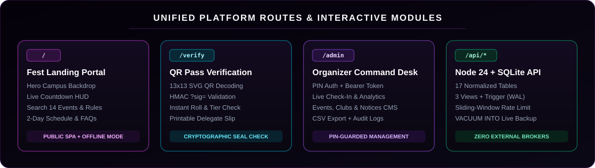
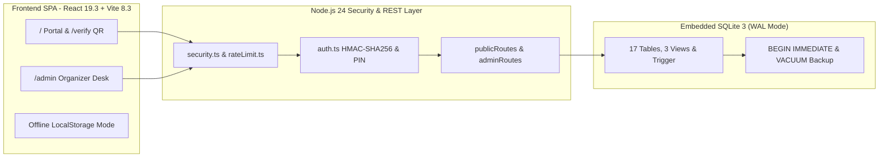

<div align="center">

<a href="https://dilkhushkumardev.github.io/TechySheikhpura/">
  
</a>

<br /><br />

<p>
  <a href="https://dilkhushkumardev.github.io/TechySheikhpura/">
    
  </a>
  <a href="https://github.com/Dilkhushkumardev/TechySheikhpura/actions/workflows/ci.yml">
    
  </a>
  <a href="https://github.com/Dilkhushkumardev/TechySheikhpura/actions/workflows/deploy-pages.yml">
    
  </a>
  <a href="LICENSE">
    
  </a>
</p>

<p>
  
  
  
  
  
  
  
</p>

<p>
  <strong>"Where Ideas Meet Innovation"</strong> — The Flagship Annual Technical, Robotics, Coding &amp; Esports Festival Portal of<br />
  <strong>Government Engineering College, Sheikhpura (GEC Sheikhpura), Bihar</strong>
</p>

[**🌐 Live Site**](https://dilkhushkumardev.github.io/TechySheikhpura/) &nbsp;•&nbsp;
[**✨ Visual Showcase**](#showcase) &nbsp;•&nbsp;
[**🎟️ Passes &amp; Events**](#passes-and-events) &nbsp;•&nbsp;
[**📅 Schedule**](#festival-schedule) &nbsp;•&nbsp;
[**🏗️ Architecture**](#architecture) &nbsp;•&nbsp;
[**🗄️ Database &amp; API**](#database-and-api) &nbsp;•&nbsp;
[**🚀 Quick Start**](#quick-start) &nbsp;•&nbsp;
[**📚 Docs**](#documentation)

</div>

---

<table width="100%">
  <tr>
    <td align="center">
      <strong>🌐 Public Live Deployment:</strong> <a href="https://dilkhushkumardev.github.io/TechySheikhpura/"><strong>dilkhushkumardev.github.io/TechySheikhpura</strong></a><br />
      <sub>GitHub Pages serves the full responsive frontend, <strong>14 events</strong>, <strong>HUD countdown</strong>, <strong>Dilkhush | Amrita | Ashish</strong> contacts &amp; offline/localStorage QR pass generator. Run <code>npm run dev</code> locally to unlock the shared <strong>17-table SQLite database</strong>, <code>/api/*</code> endpoints, and Organizer Admin Desk (<code>/admin</code>).</sub>
    </td>
  </tr>
</table>

<div align="center">

## Showcase

<p>Designed around a deep midnight void canvas (<code>#020003</code>), authentic GEC Sheikhpura campus photography, radiant neon accents, and a unified 4-surface platform architecture.</p>

<table width="100%">
  <tr>
    <td width="50%" align="center" valign="top">
      
      <p><strong>🏛️ Authentic Campus Hero Backdrop</strong><br /><sub>Government Engineering College, Sheikhpura — Administrative Block (NH-333A, Mehus)</sub></p>
    </td>
    <td width="50%" align="center" valign="top">
      
      <p><strong>🌌 Midnight Engineers Twilight Artwork</strong><br /><sub>Panoramic footer backdrop featuring glowing cyber orb &amp; outlined <strong>GEC SHEIKHPURA</strong> branding</sub></p>
    </td>
  </tr>
</table>



<br /><br />

<table width="100%">
  <tr>
    <td width="20%" align="center"><h3>⚡ 14+</h3><sub>Engineering &amp; Gaming Arenas</sub></td>
    <td width="20%" align="center"><h3>🏆 ₹10,000+</h3><sub>Cash Prize Pool &amp; Trophies</sub></td>
    <td width="20%" align="center"><h3>👥 100+</h3><sub>Expected Student Innovators</sub></td>
    <td width="20%" align="center"><h3>🎟️ 3 Tiers</h3><sub>HMAC-Sealed SVG QR Passes</sub></td>
    <td width="20%" align="center"><h3>🗄️ 17 Tables</h3><sub>SQLite WAL + 3 Analytics Views</sub></td>
  </tr>
</table>

<table width="100%">
  <tr>
    <td width="50%" align="left" valign="top">
      <h4 align="center">🎨 Cinematic Hero, Countdown &amp; Discovery</h4>
      <ul>
        <li><strong>Pitch-Midnight Design Language:</strong> Obsidian cards (<code>#0b0b11</code>), ambient cursor glow spotlight, <code>ParticleCanvas</code> network background, and crisp typography (<code>Oxanium</code>, <code>Space Grotesk</code>, <code>Plus Jakarta Sans</code>, <code>Barlow Condensed</code>).</li>
        <li><strong>Live HUD Countdown Ticker:</strong> Real-time Days : Hours : Minutes : Seconds clock synchronized to <strong>September 28–29, 2026 (09:00 IST)</strong>.</li>
        <li><strong>Instant Arena Search &amp; Rule Modals:</strong> Substring search across titles, categories, venues &amp; descriptions, paired with modal rulebooks and student coordinator contacts.</li>
        <li><strong>Interactive Schedule &amp; Announcements:</strong> Tabbed <strong>Day 1 / Day 2</strong> itinerary switcher plus live organizer notices and winner podium banners.</li>
      </ul>
    </td>
    <td width="50%" align="left" valign="top">
      <h4 align="center">🔐 Holographic Passes, Audio FX &amp; Admin Desk</h4>
      <ul>
        <li><strong>Zero-Dependency <code>13×13</code> SVG QR Engine:</strong> Deterministic offline/online delegate QR pass generation in <code>DelegateQrSvg.tsx</code> with <code>canvas-confetti</code> celebration and printable pass slip.</li>
        <li><strong>HMAC Cryptographic Pass Verification:</strong> Tamper-resistant <code>?sig=</code> query tokens verified via <code>GET /api/registrations/verify</code> on the public <code>/verify</code> route.</li>
        <li><strong>Organizer Command Center (<code>/admin</code>):</strong> PIN-authenticated workspace for instant attendee check-in toggles, live branch/tier analytics, RFC-4180 CSV export, and binary <code>VACUUM INTO</code> DB backups.</li>
        <li><strong>Safe Hardware Web Audio Synth:</strong> Singleton audio engine with floating mute/unmute control and resilient <code>localStorage</code> fallback for static hosting.</li>
      </ul>
    </td>
  </tr>
</table>

<table width="100%">
  <thead>
    <tr>
      <th align="center">Layer</th>
      <th align="center">Core Technologies</th>
      <th align="left">Purpose in TechySheikhpura '26</th>
    </tr>
  </thead>
  <tbody>
    <tr>
      <td align="center"><strong>UI &amp; Routing</strong></td>
      <td align="center"><code>React 19.3</code> • <code>TypeScript 7.0</code> • <code>React Router 7</code></td>
      <td>Strict type-safe SPA across <code>/</code>, <code>/verify</code>, <code>/admin</code>, and subpath-aware GitHub Pages routing</td>
    </tr>
    <tr>
      <td align="center"><strong>Styling &amp; FX</strong></td>
      <td align="center"><code>Tailwind CSS 3.4</code> • <code>Framer Motion</code> • <code>Lucide</code></td>
      <td>Responsive midnight cyber cards, smooth animations, <code>canvas-confetti</code> &amp; custom font hierarchy</td>
    </tr>
    <tr>
      <td align="center"><strong>Backend API</strong></td>
      <td align="center"><code>Node.js 24+</code> • <code>node:http</code> • <code>node:crypto</code></td>
      <td>Modular REST server with sliding-window rate limits, constant-time PIN checks &amp; HMAC tokens</td>
    </tr>
    <tr>
      <td align="center"><strong>Persistence</strong></td>
      <td align="center"><code>node:sqlite</code> (WAL Mode • Foreign Keys)</td>
      <td>17 normalized tables, 3 analytics views, update trigger, auto-seeding &amp; online snapshots</td>
    </tr>
    <tr>
      <td align="center"><strong>Quality &amp; CI</strong></td>
      <td align="center"><code>Vite 8.3</code> • <code>Oxlint</code> • <code>node:test</code></td>
      <td>Zero-warning linting, automated API/SQLite integration suite &amp; automated GitHub Pages CD</td>
    </tr>
  </tbody>
</table>

</div>

---

<div align="center">

## Passes and Events

<p>Subsidized student delegate passes unlock access across campus engineering challenges, hackathons, robotics arenas, and esports tournaments.</p>

<table width="100%">
  <tr>
    <td width="33.3%" align="center" valign="top">
      <h3>🎮 E-Sports Pass</h3>
      <h2>₹29 <del><sub>₹79</sub></del></h2>
      <p><sub>Dedicated custom-room tournament slot for <strong>BGMI Battle Royale</strong> &amp; <strong>Free Fire Clash</strong>, live stream commentary &amp; verified digital QR badge.</sub></p>
    </td>
    <td width="33.3%" align="center" valign="top">
      <h3>⭐ All-Events Pass (Popular)</h3>
      <h2>₹149 <del><sub>₹299</sub></del></h2>
      <p><sub>Full access to all <strong>Coding, Robotics, Aero, Startup, Mechanical/Civil &amp; Brain</strong> challenges + food coupons &amp; signed digital certificates.</sub></p>
    </td>
    <td width="33.3%" align="center" valign="top">
      <h3>👑 VIP Innovator Pass</h3>
      <h2>₹199 <del><sub>₹499</sub></del></h2>
      <p><sub>Priority entry across all events + <strong>HackArena mentor lounge</strong>, maker hardware toolkit access &amp; commemorative TechySheikhpura merch kit.</sub></p>
    </td>
  </tr>
</table>

### Complete 14 Flagship Events Directory

<table width="100%">
  <thead>
    <tr>
      <th align="center">#</th>
      <th align="left">Event Name</th>
      <th align="center">Category</th>
      <th align="center">Day &amp; Time</th>
      <th align="left">Campus Venue &amp; Format</th>
    </tr>
  </thead>
  <tbody>
    <tr><td align="center">01</td><td><strong>HackArena</strong></td><td align="center">Coding</td><td align="center">Day 1 • 10:30 AM</td><td>Central Computing Center — 24H Team Code Sprint (2–4 members • <code>₹18,000</code>)</td></tr>
    <tr><td align="center">02</td><td><strong>Track-O-Bot</strong></td><td align="center">Robotics</td><td align="center">Day 1 • 01:30 PM</td><td>Central Robotic Arena — Autonomous Line &amp; Obstacle Bot (1–3 members • <code>₹12,000</code>)</td></tr>
    <tr><td align="center">03</td><td><strong>AeroStrike</strong></td><td align="center">Aero &amp; Drone</td><td align="center">Day 2 • 11:00 AM</td><td>College Main Sports Grounds — Precision Drone Derby (1–2 pilots • <code>₹10,000</code>)</td></tr>
    <tr><td align="center">04</td><td><strong>Speed Stroke</strong></td><td align="center">Coding</td><td align="center">Day 1 • 03:00 PM</td><td>Lab-3, CSE Department — High-WPM Mechanical Typing &amp; Debugging (Solo)</td></tr>
    <tr><td align="center">05</td><td><strong>Pro-To-Pitch</strong></td><td align="center">Startup &amp; Pitch</td><td align="center">Day 2 • 10:30 AM</td><td>Smart Seminar Hall — Startup Prototype Investor Pitch (1–3 members)</td></tr>
    <tr><td align="center">06</td><td><strong>Decode GECS</strong></td><td align="center">Fun &amp; Brain</td><td align="center">Day 2 • 02:00 PM</td><td>Full Campus Quads — Cryptic Cipher &amp; QR Treasure Hunt (2–4 members)</td></tr>
    <tr><td align="center">07</td><td><strong>MechDash</strong></td><td align="center">Mechanical &amp; Civil</td><td align="center">Day 1 • 11:30 AM</td><td>CAD Simulation Studio — SolidWorks Parametric 3D Modeling Race</td></tr>
    <tr><td align="center">08</td><td><strong>Nirman (Bridge Crafter)</strong></td><td align="center">Mechanical &amp; Civil</td><td align="center">Day 2 • Morning</td><td>Civil Engineering Block — Popsicle Stick Truss Bridge Load Test</td></tr>
    <tr><td align="center">09</td><td><strong>BGMI Battle Royale</strong></td><td align="center">Esports</td><td align="center">Day 1 • 04:30 PM</td><td>Open Amphitheater — 25-Squad Erangel Custom Room Bracket (4 players)</td></tr>
    <tr><td align="center">10</td><td><strong>Free Fire Clash</strong></td><td align="center">Esports</td><td align="center">Day 1–2 • Arena</td><td>Esports Arena — Fast-Paced Squad Bermuda Knockout Bracket (4 players)</td></tr>
    <tr><td align="center">11</td><td><strong>TriLexicon</strong></td><td align="center">Fun &amp; Brain</td><td align="center">Day 2 • Afternoon</td><td>Seminar Hall B — Rapid-Fire Science, Tech &amp; Engineering Trivia (2 members)</td></tr>
    <tr><td align="center">12</td><td><strong>Circuitrix</strong></td><td align="center">Robotics</td><td align="center">Day 1 • Afternoon</td><td>Electronics Lab — Analog &amp; Digital Breadboard Circuit Debugging</td></tr>
    <tr><td align="center">13</td><td><strong>WebCraft Studio</strong></td><td align="center">Coding</td><td align="center">Day 2 • Morning</td><td>Central Computing Center — Responsive UI/UX &amp; Full-Stack Web Sprint</td></tr>
    <tr><td align="center">14</td><td><strong>TechnoCross</strong></td><td align="center">Fun &amp; Brain</td><td align="center">Day 1 • Afternoon</td><td>Lecture Complex — Engineering Crossword &amp; Rapid Logic Puzzle (Solo)</td></tr>
  </tbody>
</table>

</div>

---

<div align="center">

## Festival Schedule

<p>Two action-packed days hosted inside the permanent campus of <strong>Government Engineering College, Sheikhpura</strong> (<code>September 28 – 29, 2026</code>).</p>

<table width="100%">
  <thead>
    <tr>
      <th align="center">Day</th>
      <th align="center">Time Slot</th>
      <th align="left">Session Title</th>
      <th align="center">Track</th>
      <th align="left">Venue</th>
    </tr>
  </thead>
  <tbody>
    <tr><td align="center"><strong>Day 1</strong></td><td align="center">09:00 AM – 10:30 AM</td><td><strong>Grand Inauguration Ceremony</strong></td><td align="center">Ceremony</td><td>Main Auditorium, GEC Sheikhpura</td></tr>
    <tr><td align="center"><strong>Day 1</strong></td><td align="center">10:30 AM Onwards</td><td><strong>HackArena: 24-Hour Hackathon Kickoff</strong></td><td align="center">Coding</td><td>Central Computing Center</td></tr>
    <tr><td align="center"><strong>Day 1</strong></td><td align="center">11:30 AM – 01:30 PM</td><td><strong>MechDash: 3D CAD Assembly Race</strong></td><td align="center">Mechanical</td><td>CAD Simulation Studio</td></tr>
    <tr><td align="center"><strong>Day 1</strong></td><td align="center">01:30 PM – 04:30 PM</td><td><strong>Track-O-Bot: Autonomous Line Following</strong></td><td align="center">Robotics</td><td>Central Robotics Arena</td></tr>
    <tr><td align="center"><strong>Day 1</strong></td><td align="center">03:00 PM – 05:00 PM</td><td><strong>Speed Stroke: Typing Gladiators</strong></td><td align="center">Coding</td><td>Computer Lab 3</td></tr>
    <tr><td align="center"><strong>Day 1</strong></td><td align="center">04:30 PM – 07:30 PM</td><td><strong>Esports Arena: BGMI Battlegrounds</strong></td><td align="center">Esports</td><td>Open Amphitheater (Big Screen)</td></tr>
    <tr><td align="center"><strong>Day 2</strong></td><td align="center">10:00 AM – 10:30 AM</td><td><strong>HackArena Code Freeze &amp; Submission</strong></td><td align="center">Coding</td><td>Central Computing Center</td></tr>
    <tr><td align="center"><strong>Day 2</strong></td><td align="center">10:30 AM – 01:00 PM</td><td><strong>Pro-To-Pitch: Startup Investor Arena</strong></td><td align="center">Startup</td><td>Smart Seminar Hall</td></tr>
    <tr><td align="center"><strong>Day 2</strong></td><td align="center">11:00 AM – 02:00 PM</td><td><strong>AeroStrike: Drone Obstacle Derby</strong></td><td align="center">Aero</td><td>College Main Grounds</td></tr>
    <tr><td align="center"><strong>Day 2</strong></td><td align="center">02:00 PM – 05:00 PM</td><td><strong>Decode GECS: The Great Treasure Hunt</strong></td><td align="center">Fun</td><td>Admin Block Porch to Campus Quads</td></tr>
    <tr><td align="center"><strong>Day 2</strong></td><td align="center">05:30 PM – 07:30 PM</td><td><strong>Grand Valedictory &amp; Prize Distribution</strong></td><td align="center">Ceremony</td><td>Main Auditorium</td></tr>
  </tbody>
</table>

</div>

---

<div align="center">

## Architecture

<p>Layered full-stack design separating presentation, cryptographic request guarding, REST routing, and atomic SQLite persistence.</p>



<table width="100%">
  <thead>
    <tr>
      <th align="center">Security &amp; Reliability Control</th>
      <th align="center">Module</th>
      <th align="left">Implementation Details</th>
    </tr>
  </thead>
  <tbody>
    <tr><td align="center"><strong>Request Tracing &amp; Headers</strong></td><td align="center"><code>server/middleware/security.ts</code></td><td>Attaches <code>X-Request-Id</code>, CSP/XSS protection headers &amp; structured request logging</td></tr>
    <tr><td align="center"><strong>Abuse &amp; Burst Protection</strong></td><td align="center"><code>server/middleware/rateLimit.ts</code></td><td>Sliding-window IP throttling returning <code>429 Too Many Requests</code> with <code>Retry-After</code></td></tr>
    <tr><td align="center"><strong>Stateless Admin Auth</strong></td><td align="center"><code>server/middleware/auth.ts</code></td><td>Constant-time PIN comparison (<code>ORGANIZER_PIN</code>) &amp; HMAC-SHA256 signed Bearer tokens</td></tr>
    <tr><td align="center"><strong>Atomic Pass Booking</strong></td><td align="center"><code>server/db/database.ts</code></td><td><code>BEGIN IMMEDIATE</code> write transactions prevent duplicate roll numbers &amp; double-booked passes</td></tr>
    <tr><td align="center"><strong>Pass Tamper Detection</strong></td><td align="center"><code>server/routes/publicRoutes.ts</code></td><td>HMAC-SHA256 <code>?sig=</code> seals verified during <code>/api/registrations/verify</code> lookup</td></tr>
    <tr><td align="center"><strong>Graceful Shutdown &amp; Backup</strong></td><td align="center"><code>server/index.ts</code></td><td>Handles <code>SIGINT</code>/<code>SIGTERM</code> to drain sockets, flush SQLite WAL &amp; export <code>VACUUM INTO</code> snapshots</td></tr>
  </tbody>
</table>

</div>

---

<div align="center">

## Database and API

<p>Powered by built-in <strong>Node.js 24 <code>node:sqlite</code></strong> (<code>DatabaseSync</code>) with <code>PRAGMA foreign_keys = ON</code>, <code>WAL</code> journaling, automatic schema migrations (<code>schemaVersion: 4</code>), and auto-seeded domain data. See <a href="docs/BACKEND_DESIGN.md"><code>docs/BACKEND_DESIGN.md</code></a> for complete ERDs.</p>

<table width="100%">
  <thead>
    <tr>
      <th align="center">Schema Domain</th>
      <th align="center">Count</th>
      <th align="left">Normalized SQLite Objects (<code>server/db/schema.sql</code>)</th>
    </tr>
  </thead>
  <tbody>
    <tr><td align="center"><strong>Core Catalog &amp; CMS</strong></td><td align="center">8 Tables</td><td><code>fest_info</code>, <code>events</code>, <code>event_rules</code>, <code>event_coordinators</code>, <code>passes</code>, <code>pass_features</code>, <code>schedule_items</code>, <code>faqs</code></td></tr>
    <tr><td align="center"><strong>Community &amp; Live Updates</strong></td><td align="center">4 Tables</td><td><code>campus_clubs</code>, <code>organizers</code>, <code>announcements</code>, <code>event_results</code></td></tr>
    <tr><td align="center"><strong>Operations &amp; Governance</strong></td><td align="center">5 Tables</td><td><code>registrations</code>, <code>inquiries</code>, <code>activity_feed</code>, <code>audit_logs</code>, <code>schema_migrations</code></td></tr>
    <tr><td align="center"><strong>Analytics &amp; Integrity</strong></td><td align="center">3 Views + 1 Trigger</td><td><code>v_pass_tier_summary</code>, <code>v_event_registration_summary</code>, <code>v_branch_distribution</code>, <code>trg_fest_info_touch</code></td></tr>
  </tbody>
</table>

<details>
<summary><strong>🔌 Click to Inspect Complete Public &amp; Organizer Admin REST API Reference</strong></summary>

<br />

<table width="100%">
  <thead>
    <tr>
      <th align="center">Access</th>
      <th align="left">Method &amp; Endpoint</th>
      <th align="left">Functionality</th>
    </tr>
  </thead>
  <tbody>
    <tr><td align="center">Public</td><td><code>GET /api/health</code></td><td>Server status, SQLite diagnostics &amp; live entity counts</td></tr>
    <tr><td align="center">Public</td><td><code>GET /api/fest</code></td><td>Hydrates portal state (fest metadata, events, passes, schedule, FAQs, clubs, organizers, notices)</td></tr>
    <tr><td align="center">Public</td><td><code>GET /api/events</code> • <code>GET /api/events/:id/stats</code></td><td>Event catalog &amp; real-time registration telemetry per event</td></tr>
    <tr><td align="center">Public</td><td><code>GET /api/passes</code> • <code>/api/schedule</code> • <code>/api/faqs</code></td><td>Pass tiers, Day 1/2 itinerary &amp; searchable FAQ items</td></tr>
    <tr><td align="center">Public</td><td><code>GET /api/clubs</code> • <code>/api/organizers</code> • <code>/api/announcements</code> • <code>/api/results</code></td><td>Campus club chapters, organizer directory, notices &amp; winner podium</td></tr>
    <tr><td align="center">Public</td><td><code>POST /api/registrations</code> • <code>GET /api/registrations/verify</code></td><td>Atomic delegate pass registration &amp; QR/HMAC pass verification</td></tr>
    <tr><td align="center">Public</td><td><code>POST /api/inquiries</code> • <code>GET /api/activity</code></td><td>Student helpdesk tickets &amp; sanitized recent booking feed</td></tr>
    <tr><td align="center">Admin</td><td><code>POST /api/admin/auth</code> • <code>GET /api/admin/dashboard</code></td><td>HMAC Bearer authentication (<code>ORGANIZER_PIN</code>) &amp; live organizer KPIs</td></tr>
    <tr><td align="center">Admin</td><td><code>GET/PATCH/DELETE /api/admin/registrations</code> • <code>export.csv</code></td><td>Delegate roster management, QR check-in toggle &amp; RFC-4180 CSV download</td></tr>
    <tr><td align="center">Admin</td><td><code>GET /api/admin/db/stats</code> • <code>db/backup</code> • <code>audit</code></td><td>SQLite page/byte telemetry, live <code>VACUUM INTO</code> binary backup &amp; audit log</td></tr>
    <tr><td align="center">Admin</td><td><code>POST/PATCH/DELETE</code> CMS routes</td><td>Full CRUD on <code>events</code>, <code>schedule</code>, <code>faqs</code>, <code>clubs</code>, <code>organizers</code>, <code>announcements</code>, <code>results</code>, <code>fest</code> &amp; <code>passes</code></td></tr>
  </tbody>
</table>

</details>

</div>

---

<div align="center">

## Quick Start

<p><strong>Prerequisites:</strong> <strong>Node.js <code>v24.0.0+</code></strong> (required for built-in <code>node:sqlite</code>) &nbsp;•&nbsp; <strong>npm</strong></p>

</div>

```bash
# 1. Clone the repository & install dependencies
git clone https://github.com/Dilkhushkumardev/TechySheikhpura.git
cd TechySheikhpura
npm install

# 2. Launch Full-Stack Development (Vite :5173 + Node API :5000 + SQLite)
npm run dev

# 3. Verify linting, integration tests, production build & unified server
npm run lint     # Oxlint across frontend & backend (0 warnings, 0 errors)
npm test         # Automated node:test API & SQLite integration suite (4/4 passing)
npm run build    # Strict TypeScript build (tsc -b) + Vite production bundle into dist/
npm start        # Unified production HTTP server serving API + compiled dist/ SPA
```

<div align="center">

<table width="100%">
  <thead>
    <tr>
      <th align="center">Service Surface</th>
      <th align="center">Local Endpoint</th>
      <th align="left">Notes</th>
    </tr>
  </thead>
  <tbody>
    <tr><td align="center"><strong>Fest Landing Portal</strong></td><td align="center"><code>http://localhost:5173/</code></td><td>Vite HMR frontend with automatic <code>/api</code> proxy to port <code>5000</code></td></tr>
    <tr><td align="center"><strong>Pass Verification Portal</strong></td><td align="center"><code>http://localhost:5173/verify</code></td><td>Public delegate pass ID &amp; HMAC QR verification desk</td></tr>
    <tr><td align="center"><strong>Organizer Admin Desk</strong></td><td align="center"><code>http://localhost:5173/admin</code></td><td>Staff dashboard (default dev PIN: <code>GECS2026</code> via <code>ORGANIZER_PIN</code>)</td></tr>
    <tr><td align="center"><strong>Backend API &amp; Health</strong></td><td align="center"><code>http://localhost:5000/api/health</code></td><td>Persisted SQLite DB at <code>server/data/techysheikhpura.db</code></td></tr>
  </tbody>
</table>

<table width="100%">
  <thead>
    <tr>
      <th align="center">Deployment Target</th>
      <th align="center">Mode</th>
      <th align="left">How It Works</th>
    </tr>
  </thead>
  <tbody>
    <tr><td align="center"><strong>GitHub Pages CI/CD</strong></td><td align="center">Static Frontend SPA</td><td><code>.github/workflows/deploy-pages.yml</code> builds with <code>VITE_BASE_PATH=/TechySheikhpura/</code>, copies <code>dist/index.html</code> to <code>dist/404.html</code> for SPA routing &amp; activates <code>localStorage</code> pass fallback.</td></tr>
    <tr><td align="center"><strong>Full-Stack Node Host</strong></td><td align="center">Unified API + SQLite + SPA</td><td>Run <code>npm run build &amp;&amp; npm start</code> (or point static frontend <code>VITE_API_URL</code> to your deployed Node 24 API origin).</td></tr>
  </tbody>
</table>

<details>
<summary><strong>⚙️ Click to View Environment Variables (.env.example), Test Suite &amp; Project Structure</strong></summary>

<br />

<table width="100%">
  <thead>
    <tr>
      <th align="center">Variable</th>
      <th align="center">Default</th>
      <th align="left">Purpose</th>
    </tr>
  </thead>
  <tbody>
    <tr><td align="center"><code>PORT</code> / <code>HOST</code></td><td align="center"><code>5000</code> / <code>0.0.0.0</code></td><td>Backend HTTP server bind address</td></tr>
    <tr><td align="center"><code>DB_PATH</code></td><td align="center"><code>./server/data/techysheikhpura.db</code></td><td>Embedded SQLite database file path</td></tr>
    <tr><td align="center"><code>ORGANIZER_PIN</code></td><td align="center"><code>GECS2026</code></td><td>Admin login PIN validated by <code>/api/admin/auth</code></td></tr>
    <tr><td align="center"><code>SESSION_SECRET</code></td><td align="center">Dev fallback secret</td><td>HMAC-SHA256 signing secret (configure random 64-char secret in production)</td></tr>
    <tr><td align="center"><code>ADMIN_TOKEN_TTL_HOURS</code></td><td align="center"><code>12</code></td><td>Admin Bearer token lifetime in hours</td></tr>
    <tr><td align="center"><code>VITE_API_URL</code></td><td align="center">Empty string</td><td>External Node API origin when deploying frontend separately</td></tr>
    <tr><td align="center"><code>VITE_BASE_PATH</code></td><td align="center"><code>/</code></td><td>Subpath base (<code>/TechySheikhpura/</code> automatically set in GitHub Pages workflow)</td></tr>
  </tbody>
</table>

<div align="left">

**Automated Integration Test Coverage (`server/tests/api.test.ts` — `4 / 4` Passing):**
- Seeds the 17-table SQLite catalog and verifies security headers on `GET /api/health` and `GET /api/fest`.
- Books a delegate pass atomically, enforces duplicate registration protection, and verifies the HMAC-signed pass on `/api/registrations/verify`.
- Validates student helpdesk inquiry payloads and stores support tickets in SQLite (`POST /api/inquiries`).
- Issues HMAC-signed admin Bearer tokens, exercises full organizer CRUD, downloads RFC-4180 CSV exports, and checks rate limiting.

```text
TechySheikhpura/
├── .github/workflows/              # ci.yml, datadog-synthetics.yml & deploy-pages.yml
├── docs/                           # PRD, Architecture, Backend Design, Security, Test Plan & SVGs
├── public/                         # gecs-campus.jpg, footer-bg.jpg & favicon.svg
├── server/
│   ├── config/env.ts               # .env loader & typed backend runtime configuration
│   ├── db/
│   │   ├── schema.sql              # 17 normalized tables, 3 analytics views & update trigger
│   │   └── database.ts             # WAL-mode DatabaseSync, migrations, seeding & backups
│   ├── middleware/                 # HMAC auth tokens, sliding-window rate limiter & security headers
│   ├── routes/                     # Modular publicRoutes, adminRoutes & validation helpers
│   ├── tests/api.test.ts           # node:test end-to-end API & SQLite integration suite
│   ├── app.ts                      # HTTP handler factory + dist/ SPA static server fallback
│   ├── dev.mjs                     # Concurrent Backend (:5000) + Vite (:5173) dev launcher
│   └── index.ts                    # Node 24 HTTP server & graceful SIGINT/SIGTERM shutdown
├── src/
│   ├── components/
│   │   ├── common/ParticleCanvas.tsx
│   │   └── techy/                  # CountdownTimer, DelegateQrSvg, Modals, Helpdesk, Navbar, Footer
│   ├── data/techySheikhpuraData.ts # Baseline 14 events, 3 pass tiers, schedule, clubs & organizers
│   ├── pages/                      # TechySheikhpuraPage, VerifyPassPage, AdminDashboardPage, NotFound
│   ├── services/api.ts             # Typed frontend REST client & localStorage fallback bridge
│   └── App.tsx                     # Subpath-aware BrowserRouter root shell
├── .env.example                    # Environment configuration template
├── .markdownlint.json              # Markdown formatting configuration for rich HTML blocks
├── index.html                      # Entry HTML with Oxanium, Space Grotesk & Plus Jakarta Sans fonts
├── package.json                    # Scripts & dependencies
└── vite.config.ts                  # Vite 8 bundler with VITE_BASE_PATH & /api proxy
```

</div>

</details>

</div>

---

<div align="center">

## Documentation

<table width="100%">
  <tr>
    <td width="33.3%" align="center"><a href="docs/BACKEND_DESIGN.md"><strong>🗄️ Backend &amp; DB Design</strong></a><br /><sub>17-table SQLite ERD &amp; API pipeline</sub></td>
    <td width="33.3%" align="center"><a href="docs/ARCHITECTURE.md"><strong>🏗️ System Architecture</strong></a><br /><sub>Component hierarchy &amp; data flow</sub></td>
    <td width="33.3%" align="center"><a href="docs/PRD.md"><strong>📋 Product Requirements</strong></a><br /><sub>Functional specs &amp; user journeys</sub></td>
  </tr>
  <tr>
    <td width="33.3%" align="center"><a href="docs/DESIGN.md"><strong>🎨 Design System</strong></a><br /><sub>Palette tokens &amp; typography</sub></td>
    <td width="33.3%" align="center"><a href="docs/SECURITY.md"><strong>🛡️ Security Model</strong></a><br /><sub>HMAC auth &amp; rate limiting</sub></td>
    <td width="33.3%" align="center"><a href="docs/TEST_PLAN.md"><strong>🧪 Test Plan</strong></a><br /><sub>SQLite &amp; API verification suite</sub></td>
  </tr>
</table>

</div>

---

<div align="center">

## Clubs and Contacts

<table width="100%">
  <thead>
    <tr>
      <th align="center">Campus Chapter</th>
      <th align="center">Focus Domain</th>
      <th align="center">Student Lead</th>
    </tr>
  </thead>
  <tbody>
    <tr><td align="center"><strong>CodeGECS Club</strong></td><td align="center">Coding &amp; HackArena</td><td align="center">Aryan Raj</td></tr>
    <tr><td align="center"><strong>RoboGEC Society</strong></td><td align="center">Robotics &amp; Track-O-Bot</td><td align="center">Aditya Prakash</td></tr>
    <tr><td align="center"><strong>AeroX Flight Wing</strong></td><td align="center">AeroStrike Drone Derby</td><td align="center">Rohan Patel</td></tr>
    <tr><td align="center"><strong>E-Cell Sheikhpura</strong></td><td align="center">Pro-To-Pitch Startups</td><td align="center">Pooja Sharma</td></tr>
    <tr><td align="center"><strong>GECS Esports Guild</strong></td><td align="center">BGMI &amp; Free Fire</td><td align="center">Vikash Gupta</td></tr>
  </tbody>
</table>

<p>
  <strong>Core Student Contacts:</strong> Dilkhush &nbsp;•&nbsp; Amrita &nbsp;•&nbsp; Ashish<br />
  <strong>Chief Patron:</strong> Dr. Anil Singh Yadav (Principal, GEC Sheikhpura) &nbsp;•&nbsp; <strong>Engineered By:</strong> Team Hunter<br />
  <strong>Campus Venue:</strong> Government Engineering College, Sheikhpura — NH-333A, Mehus, Bihar 811105
</p>

<hr />

<p>
  <strong>TechySheikhpura '26</strong> • Official Technical Festival Portal of <strong>GEC Sheikhpura</strong><br />
  Licensed under the <a href="LICENSE">MIT License</a> &nbsp;•&nbsp; <a href="#showcase">✨ Showcase</a> &nbsp;•&nbsp; <a href="#passes-and-events">🎟️ Passes &amp; Events</a> &nbsp;•&nbsp; <a href="#festival-schedule">📅 Schedule</a> &nbsp;•&nbsp; <a href="#quick-start">🚀 Quick Start</a>
</p>

</div>
