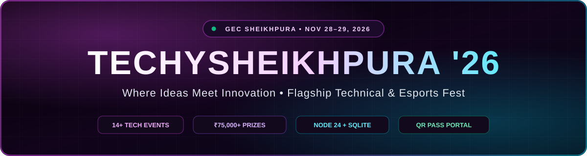
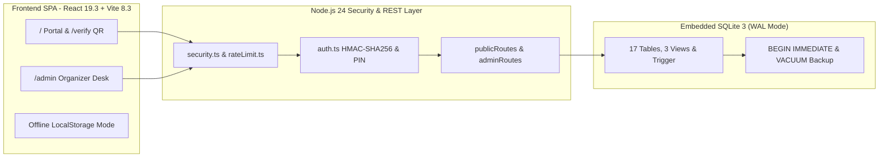

<div align="center">

<a href="https://dilkhushkumardev.github.io/TechySheikhpura/">
  
</a>

<br /><br />

<p>
  <a href="https://dilkhushkumardev.github.io/TechySheikhpura/">
    
  </a>
  <a href="https://github.com/Dilkhushkumardev/TechySheikhpura/actions/workflows/ci.yml">
    
  </a>
  <a href="https://github.com/Dilkhushkumardev/TechySheikhpura/actions/workflows/deploy-pages.yml">
    
  </a>
  <a href="LICENSE">
    
  </a>
</p>

<p>
  
  
  
  
  
  
  
</p>

<p>
  <strong>"Where Ideas Meet Innovation"</strong> — Official Annual Technical, Robotics, Coding &amp; Esports Festival Portal of <strong>Government Engineering College, Sheikhpura (GEC Sheikhpura), Bihar</strong>.
</p>

[**🌐 Live Site**](https://dilkhushkumardev.github.io/TechySheikhpura/) &nbsp;•&nbsp;
[**✨ Showcase**](#showcase) &nbsp;•&nbsp;
[**🎟️ Passes &amp; Events**](#passes-and-events) &nbsp;•&nbsp;
[**🏗️ Architecture**](#architecture) &nbsp;•&nbsp;
[**🗄️ Database &amp; API**](#database-and-api) &nbsp;•&nbsp;
[**🚀 Quick Start**](#quick-start) &nbsp;•&nbsp;
[**📚 Docs**](#documentation)

</div>

---

<table width="100%">
  <tr>
    <td align="center">
      <strong>🌐 Live Public Portal:</strong> <a href="https://dilkhushkumardev.github.io/TechySheikhpura/"><strong>dilkhushkumardev.github.io/TechySheikhpura</strong></a><br />
      <sub>GitHub Pages hosts the full frontend, <strong>14 events</strong>, <strong>HUD countdown</strong>, <strong>Dilkhush | Amrita | Ashish</strong> contacts &amp; offline QR pass generator. Launch <code>npm run dev</code> locally to unlock the shared <strong>17-table SQLite DB</strong>, <code>/api/*</code> endpoints, and Organizer Desk (<code>/admin</code>).</sub>
    </td>
  </tr>
</table>

<div align="center">

## Showcase

<table width="100%">
  <tr>
    <td width="50%" align="center" valign="top">
      
      <p><strong>🏛️ GEC Sheikhpura Campus Backdrop</strong><br /><sub>Authentic Administrative Block hero on NH-333A, Mehus</sub></p>
    </td>
    <td width="50%" align="center" valign="top">
      
      <p><strong>🌌 Midnight Cyber Twilight Artwork</strong><br /><sub>Panoramic footer scene with outlined GEC SHEIKHPURA branding</sub></p>
    </td>
  </tr>
</table>

<table width="100%">
  <tr>
    <td width="25%" align="center"><h3>⚡ 14+</h3><sub>Technical &amp; Gaming Events</sub></td>
    <td width="25%" align="center"><h3>🏆 ₹75,000+</h3><sub>Cash Prize Pool &amp; Trophies</sub></td>
    <td width="25%" align="center"><h3>🎟️ 3 Tiers</h3><sub>HMAC-Sealed SVG QR Passes</sub></td>
    <td width="25%" align="center"><h3>🗄️ 17 Tables</h3><sub>SQLite WAL + 3 Analytics Views</sub></td>
  </tr>
</table>

<table width="100%">
  <tr>
    <td width="50%" align="left" valign="top">
      <h4 align="center">🎨 Frontend Experience</h4>
      <ul>
        <li><strong>Pitch-Midnight UI (<code>#020003</code>):</strong> Obsidian glass cards (<code>#0b0b11</code>), neon accents, ambient <code>ParticleCanvas</code>, and <code>Oxanium</code> + <code>Space Grotesk</code> fonts.</li>
        <li><strong>Live HUD Countdown:</strong> Real-time Days : Hours : Minutes : Seconds ticker to <strong>Nov 28–29, 2026</strong>.</li>
        <li><strong>Searchable 14-Event Arena:</strong> Instant keyword filter across 7 categories with interactive rulebook modals.</li>
        <li><strong>Safe Audio FX &amp; Confetti:</strong> Web Audio API synth sound toggle + dynamic booking confetti bursts.</li>
      </ul>
    </td>
    <td width="50%" align="left" valign="top">
      <h4 align="center">⚙️ Full-Stack Capabilities</h4>
      <ul>
        <li><strong>Zero-Config Node 24 Engine:</strong> Built purely on <code>node:http</code>, <code>node:sqlite</code>, <code>node:crypto</code>, and <code>node:test</code>.</li>
        <li><strong>Deterministic QR Pass Portal:</strong> <code>13×13</code> SVG passes with HMAC seals &amp; instant public verification at <code>/verify</code>.</li>
        <li><strong>Organizer Admin Desk:</strong> PIN-protected (<code>/admin</code>) check-in scanner, CMS editor, CSV export &amp; SQLite backup.</li>
        <li><strong>Resilient Offline Mode:</strong> Seamless <code>localStorage</code> pass fallback when hosted statically on GitHub Pages.</li>
      </ul>
    </td>
  </tr>
</table>

</div>

---

<div align="center">

## Passes and Events

<table width="100%">
  <tr>
    <td width="33.3%" align="center" valign="top">
      <h3>🎮 E-Sports Pass</h3>
      <h2>₹29 <del><sub>₹79</sub></del></h2>
      <p><sub>BGMI Battle Royale &amp; Free Fire Clash tournament slot + verified digital QR pass</sub></p>
    </td>
    <td width="33.3%" align="center" valign="top">
      <h3>⭐ All-Events Pass</h3>
      <h2>₹149 <del><sub>₹299</sub></del></h2>
      <p><sub>Full access to all coding, robotics, aero, pitch &amp; brain events + food coupons &amp; certificate</sub></p>
    </td>
    <td width="33.3%" align="center" valign="top">
      <h3>👑 VIP Innovator Pass</h3>
      <h2>₹199 <del><sub>₹499</sub></del></h2>
      <p><sub>Priority entry + HackArena mentor lounge, hardware toolkit access &amp; merch pack</sub></p>
    </td>
  </tr>
</table>

<details>
<summary><strong>🏆 Click to View All 14 Flagship Events (Categories, Schedule &amp; Venues)</strong></summary>

<br />

<table width="100%">
  <thead>
    <tr>
      <th align="left">Event</th>
      <th align="center">Category</th>
      <th align="center">Schedule &amp; Venue</th>
      <th align="left">Highlights</th>
    </tr>
  </thead>
  <tbody>
    <tr><td><strong>HackArena</strong></td><td align="center">Coding</td><td align="center">Day 1 • Central Computing Center</td><td>24-hour collaborative code sprint (<code>₹18,000</code>)</td></tr>
    <tr><td><strong>Track-O-Bot</strong></td><td align="center">Robotics</td><td align="center">Day 1 • Central Robotic Arena</td><td>Autonomous line follower &amp; obstacle bot (<code>₹12,000</code>)</td></tr>
    <tr><td><strong>AeroStrike</strong></td><td align="center">Aero &amp; Drone</td><td align="center">Day 2 • Main Sports Grounds</td><td>Precision quadcopter &amp; RC obstacle derby (<code>₹10,000</code>)</td></tr>
    <tr><td><strong>Speed Stroke</strong></td><td align="center">Coding</td><td align="center">Day 1 • Lab-3, CSE Department</td><td>High-pressure mechanical typing &amp; debugging</td></tr>
    <tr><td><strong>Pro-To-Pitch</strong></td><td align="center">Startup &amp; Pitch</td><td align="center">Day 2 • Seminar Hall A</td><td>Startup prototype investor pitch showcase</td></tr>
    <tr><td><strong>Decode GECS</strong></td><td align="center">Fun &amp; Brain</td><td align="center">Day 1 • Full Campus</td><td>Cryptic campus-wide technical treasure hunt</td></tr>
    <tr><td><strong>MechDash</strong></td><td align="center">Mechanical &amp; Civil</td><td align="center">Day 1 • CAD Lab</td><td>Parametric 3D CAD modeling speed race</td></tr>
    <tr><td><strong>Nirman (Bridge Crafter)</strong></td><td align="center">Mechanical &amp; Civil</td><td align="center">Day 2 • Civil Block</td><td>Popsicle stick truss bridge load test</td></tr>
    <tr><td><strong>BGMI Battle Royale</strong></td><td align="center">Esports</td><td align="center">Day 1–2 • Esports Arena</td><td>Competitive squad tournament</td></tr>
    <tr><td><strong>Free Fire Clash</strong></td><td align="center">Esports</td><td align="center">Day 1–2 • Esports Arena</td><td>High-tempo tactical knockout bracket</td></tr>
    <tr><td><strong>TriLexicon</strong></td><td align="center">Fun &amp; Brain</td><td align="center">Day 2 • Seminar Hall B</td><td>Rapid science, engineering &amp; tech trivia</td></tr>
    <tr><td><strong>Circuitrix</strong></td><td align="center">Robotics</td><td align="center">Day 1 • Electronics Lab</td><td>Analog &amp; digital breadboard debugging</td></tr>
    <tr><td><strong>WebCraft Studio</strong></td><td align="center">Coding</td><td align="center">Day 2 • Central Computing Center</td><td>Responsive UI/UX &amp; web sprint</td></tr>
    <tr><td><strong>TechnoCross</strong></td><td align="center">Fun &amp; Brain</td><td align="center">Day 1 • Lecture Complex</td><td>Engineering crossword &amp; logic puzzle</td></tr>
  </tbody>
</table>

</details>

</div>

---

<div align="center">

## Architecture



</div>

---

<div align="center">

## Database and API

<p>Built on native <strong>Node.js 24</strong> modules with automatic schema migrations, WAL concurrency, atomic pass writes, and zero external dependencies. See <a href="docs/BACKEND_DESIGN.md"><code>docs/BACKEND_DESIGN.md</code></a> for full ERDs.</p>

<details>
<summary><strong>📐 Click to Inspect 17 SQLite Tables, 3 Views &amp; Trigger</strong></summary>

<br />

<div align="left">

- **Core Catalog &amp; CMS (8 tables):** `fest_info`, `events`, `event_rules`, `event_coordinators`, `passes`, `pass_features`, `schedule_items`, `faqs`
- **Campus Community &amp; Live Notices (4 tables):** `campus_clubs`, `organizers`, `announcements`, `event_results`
- **Operations &amp; Auditability (5 tables):** `registrations` (with HMAC `?sig=` seal), `inquiries`, `activity_feed`, `audit_logs`, `schema_migrations` (`schemaVersion: 3`)
- **Views &amp; Triggers:** `v_pass_tier_summary`, `v_event_registration_summary`, `v_branch_distribution`, and `trg_fest_info_touch`

</div>

</details>

<details>
<summary><strong>🔌 Click to Inspect Public &amp; Admin REST API Endpoints</strong></summary>

<br />

<table width="100%">
  <thead>
    <tr>
      <th align="center">Scope</th>
      <th align="left">Method &amp; Route</th>
      <th align="left">Responsibility</th>
    </tr>
  </thead>
  <tbody>
    <tr><td align="center">Public</td><td><code>GET /api/health</code></td><td>Runtime status, DB readiness &amp; live row telemetry</td></tr>
    <tr><td align="center">Public</td><td><code>GET /api/fest</code></td><td>Full portal bundle (events, passes, schedule, FAQs, clubs, organizers, notices)</td></tr>
    <tr><td align="center">Public</td><td><code>GET /api/events</code> • <code>/api/events/:id/stats</code></td><td>Event catalog &amp; real-time registration counts</td></tr>
    <tr><td align="center">Public</td><td><code>GET /api/passes</code> • <code>/api/schedule</code> • <code>/api/faqs</code></td><td>Pass tiers, Day 1/2 itinerary &amp; searchable FAQs</td></tr>
    <tr><td align="center">Public</td><td><code>GET /api/clubs</code> • <code>/api/organizers</code> • <code>/api/announcements</code> • <code>/api/results</code></td><td>Campus clubs, coordinators, live notices &amp; winner podium</td></tr>
    <tr><td align="center">Public</td><td><code>POST /api/registrations</code> • <code>GET /api/registrations/verify</code></td><td>Atomic pass booking &amp; QR/HMAC verification</td></tr>
    <tr><td align="center">Public</td><td><code>POST /api/inquiries</code> • <code>GET /api/activity</code></td><td>Student helpdesk tickets &amp; sanitized live feed</td></tr>
    <tr><td align="center">Admin</td><td><code>POST /api/admin/auth</code> • <code>GET /api/admin/dashboard</code></td><td>HMAC Bearer auth (<code>ORGANIZER_PIN</code>) &amp; desk metrics</td></tr>
    <tr><td align="center">Admin</td><td><code>GET/PATCH/DELETE /api/admin/registrations</code> • <code>export.csv</code></td><td>Delegate management, check-in toggle &amp; CSV export</td></tr>
    <tr><td align="center">Admin</td><td><code>GET /api/admin/db/stats</code> • <code>db/backup</code> • <code>audit</code></td><td>SQLite diagnostics, <code>VACUUM INTO</code> backup &amp; audit log</td></tr>
    <tr><td align="center">Admin</td><td><code>POST/PATCH/DELETE</code> CMS resources</td><td>Full CRUD for events, schedule, FAQs, clubs, organizers &amp; results</td></tr>
  </tbody>
</table>

</details>

</div>

---

<div align="center">

## Quick Start

<p><strong>Prerequisites:</strong> Node.js <code>v24.0.0+</code> (required for built-in <code>node:sqlite</code>) &amp; npm</p>

</div>

```bash
# 1. Clone & install
git clone https://github.com/Dilkhushkumardev/TechySheikhpura.git
cd TechySheikhpura
npm install

# 2. Launch Full-Stack Dev Mode (Frontend :5173 + Backend :5000 + SQLite)
npm run dev

# 3. Verify, build & serve unified production bundle
npm run lint     # Static analysis across client + server (0 errors)
npm test         # End-to-end backend API & SQLite integration tests
npm run build    # Typecheck (tsc -b) + Vite production build into dist/
npm start        # Unified production server (API + compiled dist/ SPA)
```

<div align="center">

<table width="100%">
  <thead>
    <tr>
      <th align="center">Local Endpoint</th>
      <th align="center">URL</th>
      <th align="left">Description</th>
    </tr>
  </thead>
  <tbody>
    <tr><td align="center"><strong>Fest Portal</strong></td><td align="center"><code>http://localhost:5173/</code></td><td>Main SPA with Vite HMR &amp; <code>/api</code> proxy</td></tr>
    <tr><td align="center"><strong>Pass Verification</strong></td><td align="center"><code>http://localhost:5173/verify</code></td><td>QR pass &amp; HMAC signature verification page</td></tr>
    <tr><td align="center"><strong>Organizer Desk</strong></td><td align="center"><code>http://localhost:5173/admin</code></td><td>Admin dashboard (default dev PIN: <code>GECS2026</code>)</td></tr>
    <tr><td align="center"><strong>API Health</strong></td><td align="center"><code>http://localhost:5000/api/health</code></td><td>SQLite storage in <code>server/data/techysheikhpura.db</code></td></tr>
  </tbody>
</table>

<details>
<summary><strong>⚙️ Click to View Environment Variables (.env.example) &amp; Project Structure</strong></summary>

<br />

<table width="100%">
  <thead>
    <tr>
      <th align="center">Variable</th>
      <th align="center">Default</th>
      <th align="left">Purpose</th>
    </tr>
  </thead>
  <tbody>
    <tr><td align="center"><code>PORT</code> / <code>HOST</code></td><td align="center"><code>5000</code> / <code>0.0.0.0</code></td><td>Backend HTTP server bind address</td></tr>
    <tr><td align="center"><code>DB_PATH</code></td><td align="center"><code>./server/data/techysheikhpura.db</code></td><td>Embedded SQLite database file path</td></tr>
    <tr><td align="center"><code>ORGANIZER_PIN</code></td><td align="center"><code>GECS2026</code></td><td>Admin login PIN for <code>/api/admin/auth</code></td></tr>
    <tr><td align="center"><code>SESSION_SECRET</code></td><td align="center">Dev fallback</td><td>HMAC-SHA256 signing secret (set 64-char secret in production)</td></tr>
    <tr><td align="center"><code>ADMIN_TOKEN_TTL_HOURS</code></td><td align="center"><code>12</code></td><td>Admin Bearer token lifetime in hours</td></tr>
    <tr><td align="center"><code>VITE_API_URL</code></td><td align="center">Empty string</td><td>External Node API origin when deploying frontend separately</td></tr>
    <tr><td align="center"><code>VITE_BASE_PATH</code></td><td align="center"><code>/</code></td><td>Subpath base (<code>/TechySheikhpura/</code> set in GitHub Pages workflow)</td></tr>
  </tbody>
</table>

<div align="left">

```text
TechySheikhpura/
├── .github/workflows/              # CI build/lint, Datadog synthetics & GitHub Pages deploy
├── docs/                           # PRD, Architecture, Backend Design, Security & Test Plan
├── public/                         # GEC Sheikhpura campus photo, twilight art & favicon.svg
├── server/
│   ├── config/env.ts               # .env loader & typed backend runtime config
│   ├── db/                         # 17-table schema.sql, views, triggers & database.ts
│   ├── middleware/                 # HMAC auth, sliding-window rate limiter & security headers
│   ├── routes/                     # Modular public & admin REST endpoints + CSV export
│   ├── tests/api.test.ts           # node:test end-to-end SQLite & API integration suite
│   ├── app.ts                      # HTTP handler + dist/ SPA static server fallback
│   ├── dev.mjs                     # Concurrent Backend (:5000) + Vite (:5173) dev launcher
│   └── index.ts                    # Node 24 HTTP server & graceful shutdown
├── src/
│   ├── components/                 # ParticleCanvas, CountdownTimer, QrSvg, Modals, Navbar, Footer
│   ├── data/techySheikhpuraData.ts # Baseline 14 events, 3 passes, schedule, clubs & organizers
│   ├── pages/                      # TechySheikhpuraPage, VerifyPassPage, AdminDashboardPage, 404
│   ├── services/api.ts             # Typed REST client & offline localStorage fallback
│   └── App.tsx                     # Subpath-aware BrowserRouter root shell
├── .env.example                    # Environment configuration template
├── package.json                    # Scripts & dependencies
└── vite.config.ts                  # Vite 8 bundler with VITE_BASE_PATH & /api proxy
```

</div>

</details>

</div>

---

<div align="center">

## Documentation

<table width="100%">
  <tr>
    <td width="33.3%" align="center"><a href="docs/BACKEND_DESIGN.md"><strong>🗄️ Backend &amp; DB Design</strong></a><br /><sub>17-table SQLite ERD &amp; API pipeline</sub></td>
    <td width="33.3%" align="center"><a href="docs/ARCHITECTURE.md"><strong>🏗️ System Architecture</strong></a><br /><sub>Component hierarchy &amp; data flow</sub></td>
    <td width="33.3%" align="center"><a href="docs/PRD.md"><strong>📋 Product Requirements</strong></a><br /><sub>Functional specs &amp; user journeys</sub></td>
  </tr>
  <tr>
    <td width="33.3%" align="center"><a href="docs/DESIGN.md"><strong>🎨 Design System</strong></a><br /><sub>Palette tokens &amp; typography</sub></td>
    <td width="33.3%" align="center"><a href="docs/SECURITY.md"><strong>🛡️ Security Model</strong></a><br /><sub>HMAC auth &amp; rate limiting</sub></td>
    <td width="33.3%" align="center"><a href="docs/TEST_PLAN.md"><strong>🧪 Test Plan</strong></a><br /><sub>SQLite &amp; API verification suite</sub></td>
  </tr>
</table>

</div>

---

<div align="center">

## Clubs and Contacts

<table width="100%">
  <thead>
    <tr>
      <th align="center">Campus Chapter</th>
      <th align="center">Focus Domain</th>
      <th align="center">Student Lead</th>
    </tr>
  </thead>
  <tbody>
    <tr><td align="center"><strong>CodeGECS Club</strong></td><td align="center">Coding &amp; HackArena</td><td align="center">Aryan Raj</td></tr>
    <tr><td align="center"><strong>RoboGEC Society</strong></td><td align="center">Robotics &amp; Track-O-Bot</td><td align="center">Aditya Prakash</td></tr>
    <tr><td align="center"><strong>AeroX Flight Wing</strong></td><td align="center">AeroStrike Drone Derby</td><td align="center">Rohan Patel</td></tr>
    <tr><td align="center"><strong>E-Cell Sheikhpura</strong></td><td align="center">Pro-To-Pitch Startups</td><td align="center">Pooja Sharma</td></tr>
    <tr><td align="center"><strong>GECS Esports Guild</strong></td><td align="center">BGMI &amp; Free Fire</td><td align="center">Vikash Gupta</td></tr>
  </tbody>
</table>

<p>
  <strong>Core Student Contacts:</strong> Dilkhush • Amrita • Ashish<br />
  <strong>Chief Patron:</strong> Dr. Alok Kumar Singh (Principal, GEC Sheikhpura) &nbsp;•&nbsp; <strong>Engineered By:</strong> Team Hunter
</p>

<hr />

<p>
  <strong>TechySheikhpura '26</strong> • Government Engineering College, Sheikhpura (Bihar)<br />
  Licensed under the <a href="LICENSE">MIT License</a> &nbsp;•&nbsp; <a href="#showcase">✨ Showcase</a> &nbsp;•&nbsp; <a href="#quick-start">🚀 Quick Start</a>
</p>

</div>
