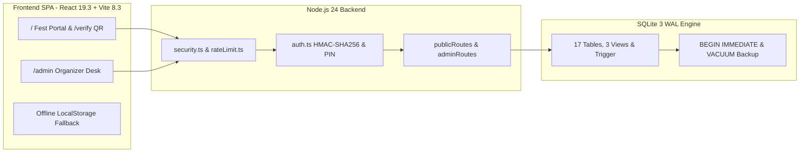

<h1 align="center">⚡ TechySheikhpura '26</h1>

<p align="center">
  <strong>"Where Ideas Meet Innovation"</strong><br />
  Official Annual Intra-College Technical, Robotics, Coding &amp; Esports Festival Portal<br />
  <strong>Government Engineering College, Sheikhpura (GEC Sheikhpura), Bihar</strong>
</p>

<p align="center">
  <a href="https://dilkhushkumardev.github.io/TechySheikhpura/">
    
  </a>
  <a href="https://github.com/Dilkhushkumardev/TechySheikhpura/actions/workflows/ci.yml">
    
  </a>
  <a href="https://github.com/Dilkhushkumardev/TechySheikhpura/actions/workflows/deploy-pages.yml">
    
  </a>
  <a href="LICENSE">
    
  </a>
</p>

<p align="center">
  
  
  
  
  
  
  
</p>

<div align="center">

[**🌐 Live Site**](https://dilkhushkumardev.github.io/TechySheikhpura/) • [**✨ Highlights**](#highlights) • [**🎟️ Passes &amp; Events**](#passes-and-events) • [**🏗️ Architecture**](#system-architecture) • [**🗄️ Database &amp; API**](#database-and-rest-api) • [**🚀 Quick Start**](#quick-start) • [**📚 Docs**](#documentation-hub)

[](https://dilkhushkumardev.github.io/TechySheikhpura/)

</div>

---

> **🌐 Live Public Portal:** **[dilkhushkumardev.github.io/TechySheikhpura](https://dilkhushkumardev.github.io/TechySheikhpura/)**
>
> GitHub Pages serves the full responsive frontend, **14 events**, **HUD countdown**, **Dilkhush | Amrita | Ashish** organizer contacts, and offline/localStorage QR pass generation. Run `npm run dev` locally to unlock the **shared 17-table SQLite database, `/api/*` endpoints, and Organizer Admin Desk (`/admin`)**.

---

## Highlights

<table>
  <tr>
    <td width="45%" valign="top">
      
      <p align="center"><sub><strong>GEC Sheikhpura Administrative Block</strong> • NH-333A, Mehus, Bihar</sub></p>
    </td>
    <td width="55%" valign="top">
      <h3>🌌 Pitch-Midnight Cyber Fest Experience</h3>
      <ul>
        <li><strong>TechVerse Aesthetic (<code>#020003</code>):</strong> High-contrast obsidian cards (<code>#0b0b11</code>), neon fuchsia/cyan accents, ambient <code>ParticleCanvas</code>, and <code>Oxanium</code> + <code>Space Grotesk</code> display typography.</li>
        <li><strong>Live HUD Countdown:</strong> Real-time Days : Hours : Minutes : Seconds ticker locked to <strong>November 28–29, 2026</strong>.</li>
        <li><strong>14 Competitive Arenas:</strong> Instant keyword search across 7 engineering &amp; gaming categories with modal rulebooks &amp; coordinator info.</li>
        <li><strong>HMAC-Sealed Digital QR Passes:</strong> Subsidized delegate booking with deterministic <code>13×13</code> SVG QR badges, confetti celebration, printable slip, and public <code>/verify</code> lookup.</li>
        <li><strong>Zero-Config Node 24 + SQLite Engine:</strong> Native <code>node:sqlite</code> (WAL mode, views, triggers, CSV export, and online <code>VACUUM INTO</code> backups).</li>
      </ul>
    </td>
  </tr>
</table>

<div align="center">

| Key Metric | Value | Scope |
| :--- | :---: | :--- |
| **Competitive Events** | `14` | Coding, Robotics, Aero &amp; Drone, Startup, Mechanical/Civil, Esports &amp; Brain |
| **Prize Pool &amp; Reach** | `₹75,000+` | 1,200+ Expected Innovators across 2 Days |
| **Delegate Pass Tiers** | `3` | E-Sports (`₹29`), All-Events (`₹149`), VIP Innovator (`₹199`) |
| **Relational Schema** | `17` Tables | `3` SQL Analytics Views + `1` Update Trigger + Schema Versioning (`v3`) |
| **Automated Checks** | `4 / 4` Passing | `node:test` SQLite integration suite + `0` Oxlint warnings/errors |

</div>

---

## Passes and Events

### Subsidized Delegate Pass Tiers

| Pass Tier | Fee | Original | Access Scope &amp; Included Perks |
| :--- | :---: | :---: | :--- |
| **E-Sports Arena Pass** | **₹29** | ~~₹79~~ | Dedicated slot for BGMI Battle Royale &amp; Free Fire Clash + verified digital QR pass |
| **All-Events Fest Pass** ⭐ | **₹149** | ~~₹299~~ | Full access to technical, coding, robotics, drone &amp; pitch events + food coupons &amp; digital certificates |
| **VIP Innovator Pass** | **₹199** | ~~₹499~~ | Priority all-event entry + HackArena mentor lounge, hardware toolkit access &amp; commemorative merch |

<details>
<summary><strong>🏆 Explore All 14 Flagship Events (Categories, Schedule &amp; Venues)</strong></summary>

<br />

| Event | Category | Day &amp; Venue | Highlights |
| :--- | :--- | :--- | :--- |
| **HackArena** | Coding | Day 1 • Central Computing Center | 24-hour code sprint (`₹18,000` + trophies) |
| **Track-O-Bot** | Robotics | Day 1 • Central Robotic Arena | Autonomous line follower &amp; obstacle bot (`₹12,000`) |
| **AeroStrike** | Aero &amp; Drone | Day 2 • Main Sports Grounds | Precision quadcopter &amp; RC obstacle derby (`₹10,000`) |
| **Speed Stroke** | Coding | Day 1 • Lab-3, CSE Department | High-pressure mechanical typing &amp; debugging |
| **Pro-To-Pitch** | Startup &amp; Pitch | Day 2 • Seminar Hall A | Startup prototype investor pitch showcase |
| **Decode GECS** | Fun &amp; Brain | Day 1 • Full Campus | Cryptic campus-wide treasure hunt |
| **MechDash** | Mechanical &amp; Civil | Day 1 • CAD Lab | Parametric 3D CAD modeling speed race |
| **Nirman (Bridge Crafter)** | Mechanical &amp; Civil | Day 2 • Civil Engineering Block | Popsicle stick truss bridge load test |
| **BGMI Battle Royale** | Esports | Day 1–2 • Esports Arena | Competitive squad tournament |
| **Free Fire Clash** | Esports | Day 1–2 • Esports Arena | High-tempo tactical knockout bracket |
| **TriLexicon** | Fun &amp; Brain | Day 2 • Seminar Hall B | Rapid science, engineering &amp; tech trivia clash |
| **Circuitrix** | Robotics | Day 1 • Electronics Lab | Analog &amp; digital breadboard debugging |
| **WebCraft Studio** | Coding | Day 2 • Central Computing Center | Responsive UI/UX &amp; web sprint |
| **TechnoCross** | Fun &amp; Brain | Day 1 • Lecture Complex | Engineering crossword &amp; rapid logic puzzle |

</details>

---

## System Architecture



---

## Database and REST API

Built strictly on **Node.js 24 standard modules** (`node:http`, `node:sqlite`, `node:crypto`, `node:test`) with zero external database brokers. Full ER diagrams and sequence flows live in [docs/BACKEND_DESIGN.md](docs/BACKEND_DESIGN.md).

<details>
<summary><strong>📐 SQLite Schema Breakdown — 17 Tables, 3 Analytics Views &amp; Trigger</strong></summary>

<br />

- **Core Catalog &amp; CMS (8 tables):** `fest_info`, `events`, `event_rules`, `event_coordinators`, `passes`, `pass_features`, `schedule_items`, `faqs`
- **Campus Community &amp; Live Notices (4 tables):** `campus_clubs`, `organizers`, `announcements`, `event_results`
- **Operations, Verification &amp; Audit (5 tables):** `registrations` (with HMAC `?sig=` verification), `inquiries`, `activity_feed`, `audit_logs`, `schema_migrations` (`schemaVersion: 3`)
- **Database Views &amp; Triggers:** `v_pass_tier_summary`, `v_event_registration_summary`, `v_branch_distribution`, and `trg_fest_info_touch`

</details>

<details>
<summary><strong>🔌 Public &amp; Organizer Admin REST API Reference</strong></summary>

<br />

| Access | Method &amp; Endpoint | Purpose |
| :--- | :--- | :--- |
| Public | `GET /api/health` | Runtime health check, DB readiness &amp; live table counts |
| Public | `GET /api/fest` | Hydrates events, passes, schedule, FAQs, clubs, organizers &amp; notices |
| Public | `GET /api/events` • `/api/events/:id/stats` | Event catalog + real-time participant telemetry |
| Public | `GET /api/passes` • `/api/schedule` • `/api/faqs` | Pass tiers, Day 1/2 itinerary &amp; searchable FAQ items |
| Public | `GET /api/clubs` • `/api/organizers` • `/api/announcements` • `/api/results` | Club chapters, coordinators, live notices &amp; winner podium |
| Public | `POST /api/registrations` • `GET /api/registrations/verify` | Atomic pass booking (`BEGIN IMMEDIATE`) &amp; QR/HMAC pass verification |
| Public | `POST /api/inquiries` • `GET /api/activity` | Student helpdesk tickets &amp; sanitized live activity feed |
| Admin | `POST /api/admin/auth` • `GET /api/admin/dashboard` | HMAC Bearer token login (`ORGANIZER_PIN`) &amp; live analytics |
| Admin | `GET/PATCH/DELETE /api/admin/registrations` + `export.csv` | Attendee management, QR check-in toggle &amp; RFC-4180 CSV export |
| Admin | `GET /api/admin/db/stats` • `db/backup` • `audit` | Live SQLite file diagnostics, `VACUUM INTO` backup &amp; audit trail |
| Admin | `POST/PATCH/DELETE` CMS endpoints | Full CRUD for events, schedule, FAQs, clubs, organizers &amp; results |

</details>

---

## Quick Start

### Prerequisites

- **Node.js `v24.0.0+`** (required for built-in `node:sqlite`)
- **npm**

### 1. Clone and Install

```bash
git clone https://github.com/Dilkhushkumardev/TechySheikhpura.git
cd TechySheikhpura
npm install
```

### 2. Start Full-Stack Development

```bash
npm run dev
```

| Service | Local URL | Notes |
| :--- | :--- | :--- |
| **Fest Landing Portal** | `http://localhost:5173/` | Vite HMR + `/api` proxy to `:5000` |
| **Pass Verification Desk** | `http://localhost:5173/verify` | QR code &amp; Pass ID verification |
| **Organizer Admin Console** | `http://localhost:5173/admin` | Default dev PIN: `GECS2026` (`ORGANIZER_PIN` in `.env`) |
| **Backend API &amp; Health** | `http://localhost:5000/api/health` | SQLite stored in `server/data/techysheikhpura.db` |

### 3. Verify, Build and Serve Production

```bash
# Static analysis across frontend & backend (0 warnings/errors)
npm run lint

# Automated end-to-end backend API & SQLite integration tests
npm test

# TypeScript strict check + Vite production bundle into dist/
npm run build

# Serve unified production API + compiled dist/ SPA
npm start
```

<details>
<summary><strong>⚙️ Environment Variables (.env.example) &amp; Project Structure</strong></summary>

<br />

| Variable | Default | Description |
| :--- | :--- | :--- |
| `PORT` / `HOST` | `5000` / `0.0.0.0` | Backend HTTP listener address |
| `DB_PATH` | `./server/data/techysheikhpura.db` | SQLite database file path |
| `ORGANIZER_PIN` | `GECS2026` | PIN used by `/api/admin/auth` |
| `SESSION_SECRET` | Dev fallback secret | HMAC-SHA256 signing secret (set 64-char secret in production) |
| `ADMIN_TOKEN_TTL_HOURS` | `12` | Admin Bearer token expiration window |
| `VITE_API_URL` | Empty string | External Node API origin when deploying frontend separately |
| `VITE_BASE_PATH` | `/` | Subpath base (`/TechySheikhpura/` automatically set in GitHub Pages CI) |

```text
TechySheikhpura/
├── .github/workflows/              # CI build/lint, Datadog synthetics & GitHub Pages deploy
├── docs/                           # PRD, Architecture, Backend Design, Security & Test Plan
├── public/                         # GEC Sheikhpura campus photo, twilight banner & favicon.svg
├── server/
│   ├── config/env.ts               # .env loader & typed backend runtime config
│   ├── db/                         # 17-table schema.sql, views, triggers & database.ts
│   ├── middleware/                 # HMAC auth, sliding-window rate limiter & security headers
│   ├── routes/                     # Modular public & admin REST endpoints + CSV export
│   ├── tests/api.test.ts           # node:test end-to-end SQLite & API integration suite
│   ├── app.ts                      # HTTP handler + dist/ SPA static server fallback
│   ├── dev.mjs                     # Concurrent Backend (:5000) + Vite (:5173) dev launcher
│   └── index.ts                    # Node 24 HTTP server & graceful shutdown
├── src/
│   ├── components/                 # ParticleCanvas, CountdownTimer, QrSvg, Modals, Navbar, Footer
│   ├── data/techySheikhpuraData.ts # Baseline 14 events, 3 passes, schedule, clubs & organizers
│   ├── pages/                      # TechySheikhpuraPage, VerifyPassPage, AdminDashboardPage, 404
│   ├── services/api.ts             # Typed REST client & offline localStorage fallback
│   └── App.tsx                     # Subpath-aware BrowserRouter root shell
├── .env.example                    # Environment configuration template
├── package.json                    # Scripts & dependencies
└── vite.config.ts                  # Vite 8 bundler with VITE_BASE_PATH & /api proxy
```

</details>

---

## Documentation Hub

| Document | Focus Area |
| :--- | :--- |
| [**Backend &amp; Database Design**](docs/BACKEND_DESIGN.md) | 17-table SQLite ERD, request pipeline, HMAC signing &amp; backup model |
| [**System Architecture**](docs/ARCHITECTURE.md) | Component structure, state hydration &amp; routing overview |
| [**Product Requirements (PRD)**](docs/PRD.md) | User flows, fest modules &amp; functional specifications |
| [**Design System**](docs/DESIGN.md) | `#020003` palette tokens, font hierarchy &amp; UI card proportions |
| [**Security Model**](docs/SECURITY.md) | Token verification, constant-time PIN checks &amp; rate limiting |
| [**Test Plan**](docs/TEST_PLAN.md) | Verification strategy &amp; SQLite API integration coverage |

---

## Clubs and Contacts

| Campus Chapter | Focus Domain | Student Lead |
| :--- | :--- | :--- |
| **CodeGECS Club** | Coding &amp; HackArena | Aryan Raj |
| **RoboGEC Society** | Robotics &amp; Track-O-Bot | Aditya Prakash |
| **AeroX Flight Wing** | AeroStrike Drone Derby | Rohan Patel |
| **E-Cell Sheikhpura** | Pro-To-Pitch Startups | Pooja Sharma |
| **GECS Esports Guild** | BGMI &amp; Free Fire | Vikash Gupta |

> **Core Student Contacts:** **Dilkhush** • **Amrita** • **Ashish**
>
> **Chief Patron:** Dr. Alok Kumar Singh (Principal, GEC Sheikhpura) • **Engineering By:** Team Hunter

---

<div align="center">

**TechySheikhpura '26** • Built for **Government Engineering College, Sheikhpura** • Design inspired by [TechVerse](https://techverse-dce.me/)

Licensed under the [MIT License](LICENSE) &nbsp;•&nbsp; [✨ Highlights](#highlights) &nbsp;•&nbsp; [🚀 Quick Start](#quick-start)

</div>
