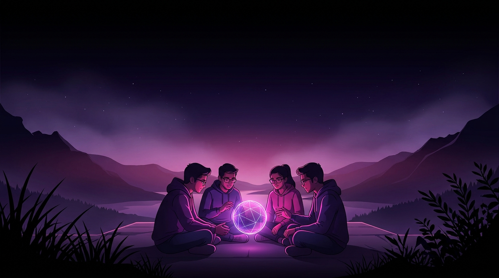
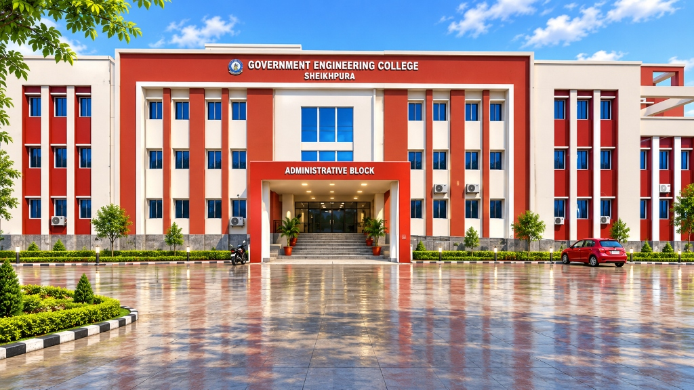
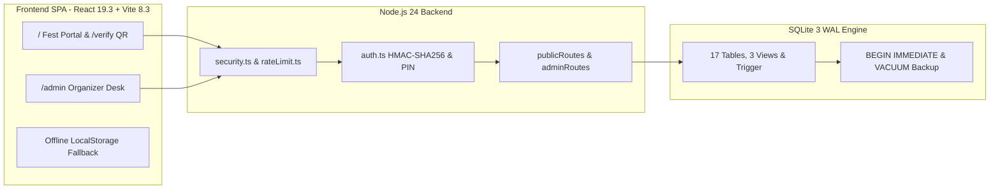

# TechySheikhpura '26

> **"Where Ideas Meet Innovation"** — Official Annual Intra-College Technical, Robotics, Coding & Esports Festival Portal of **Government Engineering College, Sheikhpura (GEC Sheikhpura), Bihar**.

[](https://dilkhushkumardev.github.io/TechySheikhpura/)
[](https://github.com/Dilkhushkumardev/TechySheikhpura/actions/workflows/ci.yml)
[](https://github.com/Dilkhushkumardev/TechySheikhpura/actions/workflows/deploy-pages.yml)
[](LICENSE)


**Quick Navigation:** [Live Website](https://dilkhushkumardev.github.io/TechySheikhpura/) • [Highlights](#highlights) • [Passes & Events](#delegate-passes-and-events) • [Architecture](#system-architecture) • [Database & API](#database-and-rest-api) • [Quick Start](#quick-start) • [Docs](#documentation-hub)

[](https://dilkhushkumardev.github.io/TechySheikhpura/)

---

> [!TIP]
> **Live Public Portal:** **[dilkhushkumardev.github.io/TechySheikhpura](https://dilkhushkumardev.github.io/TechySheikhpura/)**
>
> GitHub Pages hosts the responsive frontend, **14 events**, **countdown HUD**, **Dilkhush | Amrita | Ashish** contacts, and offline/localStorage QR pass generation. To run the **shared 17-table SQLite database, `/api/*` endpoints, and Organizer Admin Desk (`/admin`)**, launch the zero-config Node.js 24 backend locally with `npm run dev`.

---

## Highlights



*Government Engineering College, Sheikhpura — Administrative Block (NH-333A, Mehus, Sheikhpura, Bihar)*

- **TechVerse Midnight Canvas (`#020003`):** High-contrast obsidian cards (`#0b0b11`), neon fuchsia/purple/cyan accents, ambient `ParticleCanvas`, and display typography (`Oxanium`, `Space Grotesk`, `Plus Jakarta Sans`, `Barlow Condensed`).
- **Real-Time Fest Countdown:** Live HUD timer tracking **Days : Hours : Minutes : Seconds** to **November 28–29, 2026**.
- **Searchable 14-Event Arena:** Instant keyword filtering across 7 engineering and gaming categories with rulebook & coordinator modals.
- **HMAC-Sealed Digital QR Passes:** Deterministic `13x13` holographic SVG QR passes with confetti bursts, printable slips, and public `/verify` lookup.
- **Zero-Config Node 24 + SQLite Engine:** Built-in `node:sqlite` (WAL mode, triggers, views, CSV export, and `VACUUM INTO` backups) with zero external DB brokers.

| Key Metric | Value | Details |
| :--- | :---: | :--- |
| **Competitive Events** | `14` | Coding, Robotics, Aero & Drone, Startup, Mechanical/Civil, Esports & Brain |
| **Prize Pool & Reach** | `₹75,000+` | 1,200+ Expected Innovators across 2 Days |
| **Delegate Pass Tiers** | `3` | E-Sports (`₹29`), All-Events (`₹149`), VIP Innovator (`₹199`) |
| **Relational Schema** | `17` Tables | `3` SQL Analytics Views + `1` Update Trigger + Schema Versioning (`v3`) |
| **Quality Checks** | `4 / 4` Passing | `node:test` SQLite integration suite + `0` Oxlint warnings/errors |

---

## Delegate Passes and Events

### Subsidized Delegate Pass Tiers

| Pass Tier | Fee | Original | Access Scope & Included Perks |
| :--- | :---: | :---: | :--- |
| **E-Sports Arena Pass** | **₹29** | ~~₹79~~ | Dedicated slot for BGMI Battle Royale & Free Fire Clash + verified digital QR pass |
| **All-Events Fest Pass** (Popular) | **₹149** | ~~₹299~~ | Full access to technical, coding, robotics, drone & pitch events + coupons & certificates |
| **VIP Innovator Pass** | **₹199** | ~~₹499~~ | Priority all-event entry + HackArena mentor lounge, toolkit access & commemorative merch |

### 14 Flagship Events Directory

| Event | Category | Schedule & Venue | Highlights |
| :--- | :--- | :--- | :--- |
| **HackArena** | Coding | Day 1 • Central Computing Center | 24-hour collaborative code sprint (`₹18,000`) |
| **Track-O-Bot** | Robotics | Day 1 • Central Robotic Arena | Autonomous line follower & obstacle bot (`₹12,000`) |
| **AeroStrike** | Aero & Drone | Day 2 • Main Sports Grounds | Precision quadcopter & RC obstacle derby (`₹10,000`) |
| **Speed Stroke** | Coding | Day 1 • Lab-3, CSE Department | High-pressure mechanical typing & debugging |
| **Pro-To-Pitch** | Startup & Pitch | Day 2 • Seminar Hall A | Startup prototype investor pitch showcase |
| **Decode GECS** | Fun & Brain | Day 1 • Full Campus | Cryptic campus-wide technical treasure hunt |
| **MechDash** | Mechanical & Civil | Day 1 • CAD Lab | Parametric 3D CAD modeling speed race |
| **Nirman (Bridge Crafter)** | Mechanical & Civil | Day 2 • Civil Engineering Block | Popsicle stick truss bridge load test |
| **BGMI Battle Royale** | Esports | Day 1–2 • Esports Arena | Competitive squad tournament |
| **Free Fire Clash** | Esports | Day 1–2 • Esports Arena | High-tempo tactical knockout bracket |
| **TriLexicon** | Fun & Brain | Day 2 • Seminar Hall B | Rapid science, engineering & tech trivia |
| **Circuitrix** | Robotics | Day 1 • Electronics Lab | Analog & digital breadboard circuit debugging |
| **WebCraft Studio** | Coding | Day 2 • Central Computing Center | Responsive UI/UX & rapid web build sprint |
| **TechnoCross** | Fun & Brain | Day 1 • Lecture Complex | Engineering crossword & logic puzzle challenge |

---

## System Architecture



---

## Database and REST API

Built strictly on **Node.js 24 standard modules** (`node:http`, `node:sqlite`, `node:crypto`, `node:test`) with zero external database installation. Full ER diagrams live in [docs/BACKEND_DESIGN.md](docs/BACKEND_DESIGN.md).

### 17-Table SQLite Schema and Analytics Views

- **Core Catalog & CMS (8 tables):** `fest_info`, `events`, `event_rules`, `event_coordinators`, `passes`, `pass_features`, `schedule_items`, `faqs`
- **Campus Community & Notices (4 tables):** `campus_clubs`, `organizers`, `announcements`, `event_results`
- **Operations & Auditability (5 tables):** `registrations` (with HMAC `?sig=` verification), `inquiries`, `activity_feed`, `audit_logs`, `schema_migrations` (`schemaVersion: 3`)
- **Views & Triggers:** `v_pass_tier_summary`, `v_event_registration_summary`, `v_branch_distribution`, and `trg_fest_info_touch`

### REST API Endpoints

| Access | Method & Endpoint | Purpose |
| :--- | :--- | :--- |
| Public | `GET /api/health` | Runtime health check, DB readiness & live table counts |
| Public | `GET /api/fest` | Hydrates events, passes, schedule, FAQs, clubs, organizers & notices |
| Public | `GET /api/events` • `/api/events/:id/stats` | Event catalog + real-time participant telemetry |
| Public | `GET /api/passes` • `/api/schedule` • `/api/faqs` | Pass tiers, Day 1/2 itinerary & searchable FAQ items |
| Public | `GET /api/clubs` • `/api/organizers` • `/api/announcements` • `/api/results` | Club chapters, coordinators, live notices & winner podium |
| Public | `POST /api/registrations` • `GET /api/registrations/verify` | Atomic pass booking (`BEGIN IMMEDIATE`) & QR/HMAC verification |
| Public | `POST /api/inquiries` • `GET /api/activity` | Student helpdesk tickets & sanitized live activity feed |
| Admin | `POST /api/admin/auth` • `GET /api/admin/dashboard` | HMAC Bearer token login (`ORGANIZER_PIN`) & live metrics |
| Admin | `GET/PATCH/DELETE /api/admin/registrations` + `export.csv` | Attendee management, check-in toggle & RFC-4180 CSV export |
| Admin | `GET /api/admin/db/stats` • `db/backup` • `audit` | Live SQLite file diagnostics, `VACUUM INTO` snapshot & audit log |
| Admin | `POST/PATCH/DELETE` CMS endpoints | Full CRUD for events, schedule, FAQs, clubs, organizers & results |

---

## Quick Start

### Prerequisites

- **Node.js `v24.0.0+`** (required for built-in `node:sqlite`)
- **npm**

### 1. Clone and Install

```bash
git clone https://github.com/Dilkhushkumardev/TechySheikhpura.git
cd TechySheikhpura
npm install
```

### 2. Start Full-Stack Dev Mode

```bash
npm run dev
```

| Service | Local URL | Notes |
| :--- | :--- | :--- |
| **Fest Landing Portal** | `http://localhost:5173/` | Vite HMR + `/api` proxy to `:5000` |
| **Pass Verification Desk** | `http://localhost:5173/verify` | QR code & Pass ID verification |
| **Organizer Admin Console** | `http://localhost:5173/admin` | Default dev PIN: `GECS2026` (`ORGANIZER_PIN` in `.env`) |
| **Backend API & Health** | `http://localhost:5000/api/health` | SQLite stored in `server/data/techysheikhpura.db` |

### 3. Verify, Build and Serve

```bash
# Static analysis across frontend & backend (0 warnings/errors)
npm run lint

# Automated end-to-end backend API & SQLite integration tests
npm test

# TypeScript strict check + Vite production bundle into dist/
npm run build

# Serve unified production API + compiled dist/ SPA
npm start
```

### Environment Variables

| Variable | Default | Description |
| :--- | :--- | :--- |
| `PORT` / `HOST` | `5000` / `0.0.0.0` | Backend HTTP listener address |
| `DB_PATH` | `./server/data/techysheikhpura.db` | SQLite database file path |
| `ORGANIZER_PIN` | `GECS2026` | PIN used by `/api/admin/auth` |
| `SESSION_SECRET` | Dev fallback secret | HMAC-SHA256 signing secret (set random 64-char value in prod) |
| `ADMIN_TOKEN_TTL_HOURS` | `12` | Admin Bearer token expiration window |
| `VITE_API_URL` | Empty string | External Node API origin when deploying frontend separately |
| `VITE_BASE_PATH` | `/` | Subpath base (`/TechySheikhpura/` used in GitHub Pages CI) |

---

## Project Structure

```text
TechySheikhpura/
├── .github/workflows/
│   ├── ci.yml                      # Continuous lint, integration tests & build verification
│   ├── datadog-synthetics.yml      # Synthetic monitoring workflow
│   └── deploy-pages.yml            # Subpath build + 404 SPA fallback + GitHub Pages deploy
├── docs/                           # PRD, Architecture, Backend Design, Security & Test Plan
├── public/                         # GEC Sheikhpura campus photo, twilight banner & favicon.svg
├── server/
│   ├── config/env.ts               # .env loader & typed backend runtime config
│   ├── db/
│   │   ├── schema.sql              # 17 normalized SQLite tables, 3 analytics views & trigger
│   │   └── database.ts             # WAL-mode DatabaseSync, migrations, seeding & analytics
│   ├── middleware/                 # HMAC auth, sliding-window rate limiter & security headers
│   ├── routes/                     # Modular public & admin endpoints + CSV export
│   ├── tests/api.test.ts           # node:test end-to-end integration test suite
│   ├── app.ts                      # Request router + dist/ SPA static server fallback
│   ├── dev.mjs                     # Concurrent Backend (:5000) + Vite (:5173) dev runner
│   └── index.ts                    # Node 24 HTTP server & graceful SIGINT/SIGTERM shutdown
├── src/
│   ├── components/
│   │   ├── common/ParticleCanvas.tsx
│   │   └── techy/                  # CountdownTimer, DelegateQrSvg, Modals, Helpdesk, Navbar, Footer
│   ├── data/techySheikhpuraData.ts # Baseline 14 events, 3 pass tiers, schedule, clubs & organizers
│   ├── pages/                      # TechySheikhpuraPage, VerifyPassPage, AdminDashboardPage, NotFoundPage
│   ├── services/api.ts             # Typed REST client & offline localStorage fallback bridge
│   └── App.tsx                     # Subpath-aware BrowserRouter root shell
├── .env.example                    # Environment template
├── index.html                      # Entry HTML with Oxanium, Space Grotesk & Plus Jakarta Sans fonts
├── package.json                    # Scripts & dependencies
└── vite.config.ts                  # Vite 8 bundler with VITE_BASE_PATH & /api proxy
```

---

## Documentation Hub

| Document | Focus Area |
| :--- | :--- |
| [Backend & Database Design](docs/BACKEND_DESIGN.md) | 17-table SQLite ERD, request pipeline, HMAC signing & backup model |
| [System Architecture](docs/ARCHITECTURE.md) | Component structure, state hydration & routing overview |
| [Product Requirements (PRD)](docs/PRD.md) | User flows, fest modules & functional specifications |
| [Design System](docs/DESIGN.md) | `#020003` palette tokens, font hierarchy & UI card proportions |
| [Security Model](docs/SECURITY.md) | Token verification, constant-time PIN checks & rate limiting |
| [Test Plan](docs/TEST_PLAN.md) | Verification strategy & SQLite API integration coverage |

---

## Campus Clubs and Contacts

| Campus Chapter | Focus Domain | Student Lead |
| :--- | :--- | :--- |
| **CodeGECS Club** | Coding & HackArena | Aryan Raj |
| **RoboGEC Society** | Robotics & Track-O-Bot | Aditya Prakash |
| **AeroX Flight Wing** | AeroStrike Drone Derby | Rohan Patel |
| **E-Cell Sheikhpura** | Pro-To-Pitch Startups | Pooja Sharma |
| **GECS Esports Guild** | BGMI & Free Fire | Vikash Gupta |

> **Core Student Contacts:** **Dilkhush** • **Amrita** • **Ashish**
>
> **Chief Patron:** Dr. Alok Kumar Singh (Principal, GEC Sheikhpura) • **Engineering By:** Team Hunter

---

**TechySheikhpura '26** — Built for **Government Engineering College, Sheikhpura** • Design inspired by [TechVerse](https://techverse-dce.me/) • Licensed under the [MIT License](LICENSE) • [Back to Top](#techysheikhpura-26)
