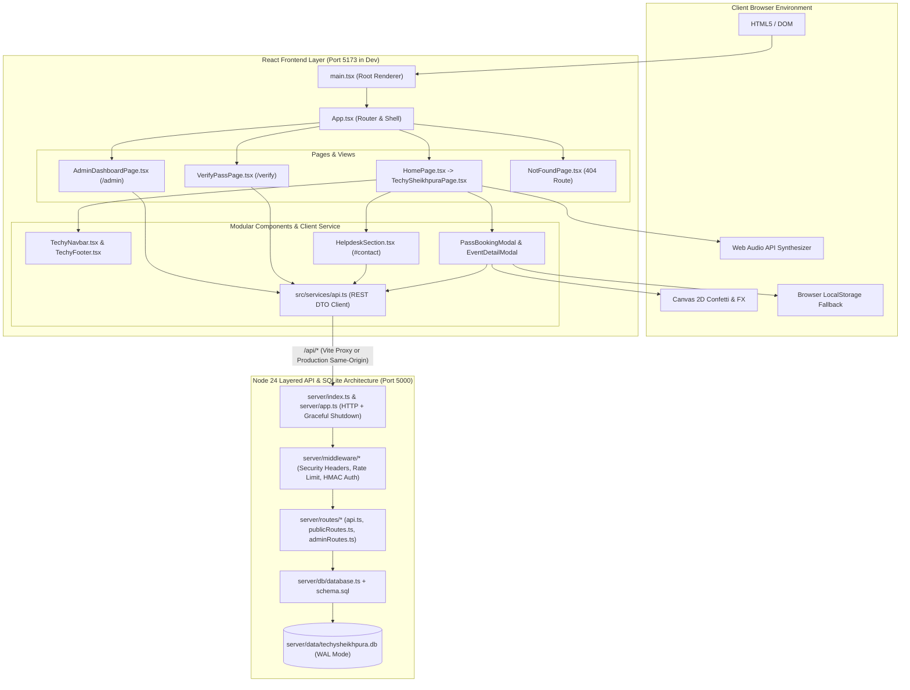
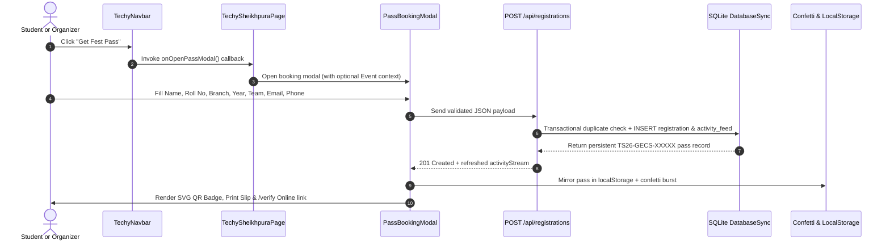

# System Architecture & Engineering Specifications

> **TechySheikhpura '26** — Full-Stack Web Application & Embedded SQLite Backend for Government Engineering College, Sheikhpura (GEC Sheikhpura).

[](https://vitejs.dev/)
[](https://react.dev/)
[](https://www.typescriptlang.org/)
[](https://nodejs.org/api/sqlite.html)

---

## 1. System Architecture Overview



---

## 2. Component Interaction & Database Registration Flow



---

## 3. Component Hierarchy & Repository Structure

```text
TechySheikhpura/
├── .github/workflows/
│   ├── ci.yml                              # Node 24 CI: npm ci, oxlint, tsc + vite build
│   └── datadog-synthetics.yml              # Guarded Datadog E2E workflow (runs when secrets set)
├── public/
│   ├── favicon.svg                         # Fest shield SVG emblem
│   ├── footer-bg.jpg                       # AI-generated panoramic twilight footer illustration
│   └── gecs-campus.jpg                     # Authenticated GEC Sheikhpura campus hero image
├── server/
│   ├── app.ts                              # HTTP handler factory & production dist/ SPA static server
│   ├── index.ts                            # Server boot, WAL initialization & SIGINT/SIGTERM shutdown
│   ├── dev.mjs                             # Clean dual-process Node backend + Vite dev launcher
│   ├── config/
│   │   └── env.ts                          # .env loader & validated runtime configuration
│   ├── middleware/
│   │   ├── auth.ts                         # HMAC-SHA256 stateless admin tokens & constant-time PIN check
│   │   ├── rateLimit.ts                    # Sliding-window API & brute-force rate limiter
│   │   └── security.ts                     # Security headers, Request-Id tracing & structured logs
│   ├── db/
│   │   ├── schema.sql                      # 17-table relational SQLite schema + views & triggers
│   │   └── database.ts                     # Idempotent auto-seed, transactions & full CRUD analytics
│   ├── routes/
│   │   ├── helpers.ts                      # HttpError, JSON/CSV writers & strict field validators
│   │   ├── publicRoutes.ts                 # Catalog, registration, verification & inquiry endpoints
│   │   ├── adminRoutes.ts                  # Token/PIN-protected organizer CRUD & CSV export
│   │   └── api.ts                          # Central API dispatcher & middleware pipeline
│   └── tests/
│       └── api.test.ts                     # Built-in node:test backend API + SQLite test suite
└── src/
    ├── App.tsx                             # BrowserRouter routes (/, /home, /verify, /admin, *)
    ├── main.tsx                            # React StrictMode DOM mount
    ├── index.css                           # Tailwind directives, custom classes & marquee CSS
    ├── services/
    │   └── api.ts                          # Strongly typed frontend API client & DTOs
    ├── data/
    │   └── techySheikhpuraData.ts          # Seed baseline: 14 Events, 3 Pass Tiers, Schedule & FAQs
    ├── pages/
    │   ├── HomePage.tsx                    # Root route wrapper rendering TechySheikhpuraPage
    │   ├── TechySheikhpuraPage.tsx         # Master fest page hydrated from /api/fest
    │   ├── VerifyPassPage.tsx              # Public /verify QR pass verification portal
    │   ├── AdminDashboardPage.tsx          # PIN-gated /admin organizer console & check-in desk
    │   └── NotFoundPage.tsx                # 404 route with Home & Events anchor recovery
    └── components/
        ├── common/
        │   └── ParticleCanvas.tsx          # Standalone particle background utility
        └── techy/
            ├── CountdownTimer.tsx          # High-contrast HUD event countdown
            ├── DelegateQrSvg.tsx           # Deterministic 13x13 SVG QR badge component
            ├── EventDetailModal.tsx        # Event rules, prize & coordinator modal
            ├── HelpdeskSection.tsx         # Student support form persisted to /api/inquiries
            ├── PassBookingModal.tsx        # SQLite-backed booking form + offline fallback
            ├── TechyNavbar.tsx             # Sticky navbar with Verify Pass, Desk & CTA links
            └── TechyFooter.tsx             # AI twilight crowd footer with Team Hunter & Telegram
```

Rendered sections inside `TechySheikhpuraPage.tsx`:

1. **Navigation (`TechyNavbar`)** — Sticky header with brand mark, anchor links (`#hero`, `#about`, `#events`, `#passes`, `#schedule`), `Verify Pass`, `Desk`, and `Get Fest Pass` action.
2. **Hero & HUD (`#hero`, `CountdownTimer`)** — GEC Sheikhpura campus backdrop, quick stats grid, live DB-fed activity ticker, fest action triggers, and countdown timer to `Nov 28, 2026`.
3. **Marquee Ticker** — Continuous seamless double-track event highlights banner.
4. **About Section (`#about`)** — Innovation pillars and campus venue overview.
5. **Events Arena (`#events`)** — Category filter pills (`All` + 7 categories), keyword search input, SQLite-backed event cards, and `EventDetailModal` trigger.
6. **Passes & Clubs (`#passes`)** — 3 pass tiers (`₹149`, `₹29`, `₹199`) launching `PassBookingModal`, plus 5 GEC Sheikhpura student clubs.
7. **Schedule, FAQs & Helpdesk (`#schedule`, `#faqs`, `#contact`)** — Day 1 / Day 2 timeline toggle, FAQ accordion, and SQLite-backed Student Helpdesk form.
8. **Footer (`TechyFooter`)** — AI twilight crowd backdrop, Team Hunter attribution, Telegram channel pill, coordinator `tel:` links, and outlined `GEC SHEIKHPURA` backdrop typography.

---

## 4. Performance & Bundle Metrics

| Metric                        | Target         | Measured Result                                                                                      |
| ----------------------------- | -------------- | ---------------------------------------------------------------------------------------------------- |
| **Production Build Time**     | `< 2.5s`       | **1.50s** (`tsc -b && vite build`)                                                                   |
| **Gzip JS Bundle Size**       | `< 130 kB`     | **120.37 kB** (`411.70 kB` raw)                                                                      |
| **Gzip CSS Bundle Size**      | `< 12 kB`      | **7.86 kB** (`41.65 kB` raw)                                                                         |
| **Linter Diagnostic Output**  | `0 Warnings`   | **0 Warnings, 0 Errors** (`oxlint` default: 116 rules across 33 files; server strict: 154 rules)     |
| **Backend Integration Suite** | `All Pass`     | **4/4 Passing** (`node:test`: SQLite seed, pass/dup 409, inquiry, HMAC auth CRUD, CSV & rate limits) |
| **TypeScript Strict Mode**    | `0 Errors`     | **`strict`, `verbatimModuleSyntax`, `erasableSyntaxOnly`, `noUnusedLocals`, `noUnusedParameters`**   |
| **GitHub Actions CI**         | `Green Checks` | **`CI Build & Lint` passing on Node 24 (`lint`, `test`, `build`); Datadog Synthetics guarded**       |
