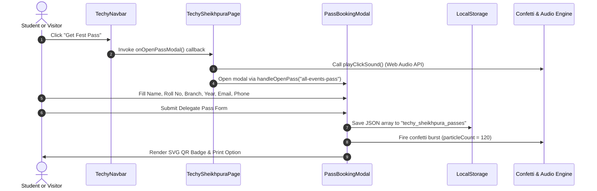

# System Architecture & Engineering Specifications

> **TechySheikhpura '26** — High-Performance Client-Side Single Page Application (SPA) for Government Engineering College, Sheikhpura (GEC Sheikhpura).

[](https://vitejs.dev/)
[](https://react.dev/)
[](https://www.typescriptlang.org/)
[](https://tailwindcss.com/)

---

## 1. System Architecture Overview


---

## 2. Component Interaction & State Flow



---

## 3. Component Hierarchy & Repository Structure

```text
TechySheikhpura/
├── .github/workflows/
│   ├── ci.yml                              # Node 24 CI: npm ci, oxlint, tsc + vite build
│   └── datadog-synthetics.yml              # Guarded Datadog E2E workflow (runs when secrets set)
├── public/
│   ├── favicon.svg                         # Fest shield SVG emblem
│   ├── footer-bg.png                       # Panoramic TechVerse footer background artwork
│   └── gecs-campus.jpg                     # Authenticated GEC Sheikhpura campus hero image
└── src/
    ├── App.tsx                             # BrowserRouter routes (/, /home, *)
    ├── main.tsx                            # React StrictMode DOM mount
    ├── index.css                           # Tailwind directives, custom classes & marquee CSS
    ├── data/
    │   └── techySheikhpuraData.ts          # 14 Events, 3 Pass Tiers, Schedule & FAQs
    ├── pages/
    │   ├── HomePage.tsx                    # Root route wrapper rendering TechySheikhpuraPage
    │   ├── TechySheikhpuraPage.tsx         # Master fest page orchestrator & modals host
    │   └── NotFoundPage.tsx                # 404 route with Home & Events anchor recovery
    └── components/
        ├── common/
        │   └── ParticleCanvas.tsx          # Standalone particle background utility (currently unmounted)
        └── techy/
            ├── CountdownTimer.tsx          # High-contrast HUD event countdown
            ├── EventDetailModal.tsx        # Event rules, prize & coordinator modal
            ├── PassBookingModal.tsx        # Interactive booking form & deterministic SVG QR pass
            ├── TechyNavbar.tsx             # Responsive sticky navigation bar
            └── TechyFooter.tsx             # TechVerse crowd footer with GEC SHEIKHPURA watermark
```

Rendered sections inside `TechySheikhpuraPage.tsx`:

1. **Navigation (`TechyNavbar`)** — Sticky header with brand mark, anchor links (`#hero`, `#about`, `#events`, `#passes`, `#schedule`), and `Get Fest Pass` action.
2. **Hero & HUD (`#hero`, `CountdownTimer`)** — GEC Sheikhpura campus backdrop, quick stats grid, fest action triggers, and countdown timer to `Nov 28, 2026`.
3. **Marquee Ticker** — Continuous seamless double-track event highlights banner.
4. **About Section (`#about`)** — Innovation pillars and campus venue overview.
5. **Events Arena (`#events`)** — Category filter pills (`All` + 7 categories), keyword search input, 14 event cards, and `EventDetailModal` trigger.
6. **Passes & Clubs (`#passes`)** — 3 pass tiers (`₹149`, `₹29`, `₹199`) launching `PassBookingModal`, plus 5 GEC Sheikhpura student clubs.
7. **Schedule & FAQs (`#schedule`, `#faqs`)** — Day 1 / Day 2 timeline toggle and expandable FAQ accordion.
8. **Footer (`TechyFooter`)** — Social links, coordinators contact block, and outlined `GEC SHEIKHPURA` backdrop typography.

---

## 4. Performance & Bundle Metrics

| Metric                       | Target         | Measured Result                                                                                      |
| ---------------------------- | -------------- | ---------------------------------------------------------------------------------------------------- |
| **Production Build Time**    | `< 2.5s`       | **1.45s** (`tsc -b && vite build`)                                                                   |
| **Gzip JS Bundle Size**      | `< 120 kB`     | **109.67 kB** (`358.44 kB` raw)                                                                      |
| **Gzip CSS Bundle Size**     | `< 12 kB`      | **7.02 kB** (`37.33 kB` raw)                                                                         |
| **Linter Diagnostic Output** | `0 Warnings`   | **0 Warnings, 0 Errors** (`oxlint` default: 116 rules; strict suspicious/perf: 155 rules)            |
| **TypeScript Strict Mode**   | `0 Errors`     | **`strict`, `verbatimModuleSyntax`, `erasableSyntaxOnly`, `noUnusedLocals`, `noUnusedParameters`**   |
| **GitHub Actions CI**        | `Green Checks` | **`CI Build & Lint` passing on Node 24; Datadog Synthetics guarded when API/APP secrets are absent** |
