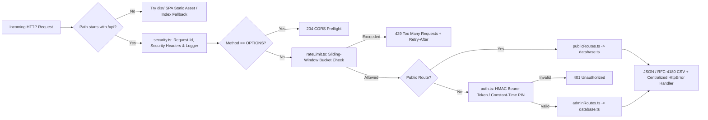

# Backend Architecture & Database System Design

> **TechySheikhpura '26** — Full-Stack Backend API & Embedded Relational SQLite Architecture for **Government Engineering College, Sheikhpura (GEC Sheikhpura)**.

---

## 1. Architectural Goals & Design Principles

1. **Zero-Config Reliability:** Runs natively on Node.js 24 (`node:http`, `node:sqlite`, `node:crypto`, `node:test`) with zero external runtime brokers or third-party database installation steps.
2. **Modular Layered Separation:**
   - **`server/config/`** — `.env` loader (`process.loadEnvFile`) & validated runtime config (`getServerConfig`).
   - **`server/middleware/`** — Request ID tracing, HTTP security headers, CORS preflight, sliding-window rate limiting, and HMAC-SHA256 stateless authentication.
   - **`server/routes/`** — Strict payload parsing/validation (`helpers.ts`), public read/booking endpoints (`publicRoutes.ts`), and organizer CRUD routes (`adminRoutes.ts`).
   - **`server/db/`** — Normalized 17-table SQLite schema (`schema.sql`), 3 SQL analytics views, triggers, schema versioning (`schema_migrations`), WAL concurrency tuning, online `VACUUM INTO` backups, and transactional persistence (`database.ts`).
   - **`server/tests/`** — Automated end-to-end API + SQLite integration suite (`api.test.ts`).
3. **Production Safe:** Atomic SQLite `BEGIN IMMEDIATE` write transactions prevent double-booked passes under concurrent bursts, while graceful `SIGINT`/`SIGTERM` handlers close HTTP sockets and flush the WAL file cleanly.

---

## 2. Backend Request Pipeline



---

## 3. Database Entity-Relationship Design (`SQLite 3 / WAL Mode`)

Foreign keys (`PRAGMA foreign_keys = ON`), 5-second lock timeout (`PRAGMA busy_timeout = 5000`), and Write-Ahead Logging (`PRAGMA journal_mode = WAL`) are active on every connection in [`initDatabase`](../server/db/database.ts).

```mermaid
erDiagram
    FEST_INFO {
        INTEGER id PK
        TEXT name
        TEXT tagline
        TEXT college_name
        TEXT short_college
        TEXT dates
        TEXT venue
        TEXT email
        TEXT phone
        TEXT student_convenor
        TEXT telegram
        TEXT stats_json
        TEXT updated_at
    }

    EVENTS {
        TEXT id PK
        TEXT title
        TEXT tagline
        TEXT category
        TEXT date
        TEXT time
        TEXT venue
        TEXT image
        TEXT description
        TEXT team_size
        TEXT entry_fee
        TEXT prizes
        INTEGER featured
        INTEGER sort_order
    }

    EVENT_RULES {
        INTEGER id PK
        TEXT event_id FK
        TEXT rule_text
        INTEGER sort_order
    }

    EVENT_COORDINATORS {
        INTEGER id PK
        TEXT event_id FK
        TEXT name
        TEXT contact
        INTEGER sort_order
    }

    PASSES {
        TEXT id PK
        TEXT name
        TEXT tagline
        INTEGER price
        INTEGER original_price
        TEXT badge
        INTEGER is_popular
        TEXT access_scope
        INTEGER sort_order
    }

    PASS_FEATURES {
        INTEGER id PK
        TEXT pass_id FK
        TEXT feature_text
        INTEGER sort_order
    }

    REGISTRATIONS {
        TEXT reg_id PK
        TEXT pass_id FK
        TEXT pass_name
        INTEGER price
        TEXT event_id FK
        TEXT event_title
        TEXT full_name
        TEXT roll_no
        TEXT branch
        TEXT year
        TEXT phone
        TEXT email
        TEXT team_name
        INTEGER checked_in
        TEXT checked_in_at
        TEXT booked_at
        TEXT created_at
    }

    SCHEDULE_ITEMS {
        TEXT id PK
        TEXT day
        TEXT time
        TEXT title
        TEXT category
        TEXT venue
        TEXT description
        INTEGER sort_order
    }

    FAQS {
        INTEGER id PK
        TEXT question
        TEXT answer
        INTEGER sort_order
    }

    INQUIRIES {
        INTEGER id PK
        TEXT name
        TEXT email
        TEXT roll_no
        TEXT subject
        TEXT message
        TEXT status
        TEXT created_at
    }

    ACTIVITY_FEED {
        INTEGER id PK
        TEXT actor_name
        TEXT branch
        TEXT action_text
        TEXT time_label
        TEXT created_at
    }

    AUDIT_LOGS {
        INTEGER id PK
        TEXT action
        TEXT target_type
        TEXT target_id
        TEXT details
        TEXT created_at
    }

    CAMPUS_CLUBS {
        TEXT id PK
        TEXT name
        TEXT role
        TEXT icon
        TEXT color_class
        TEXT lead_name
        INTEGER sort_order
    }

    ORGANIZERS {
        TEXT id PK
        TEXT name
        TEXT role
        TEXT department
        TEXT phone
        TEXT category
        INTEGER featured_footer
        INTEGER sort_order
    }

    ANNOUNCEMENTS {
        INTEGER id PK
        TEXT title
        TEXT message
        TEXT priority
        INTEGER is_active
        TEXT created_at
    }

    EVENT_RESULTS {
        INTEGER id PK
        TEXT event_id FK
        TEXT position
        TEXT winner_name
        TEXT team_name
        TEXT branch
        TEXT roll_no
        TEXT prize
        TEXT announced_at
    }

    SCHEMA_MIGRATIONS {
        INTEGER version PK
        TEXT description
        TEXT applied_at
    }

    EVENTS ||--o{ EVENT_RULES : "has rules (CASCADE)"
    EVENTS ||--o{ EVENT_COORDINATORS : "coordinated by (CASCADE)"
    EVENTS ||--o{ EVENT_RESULTS : "announces winners (CASCADE)"
    PASSES ||--o{ PASS_FEATURES : "includes features (CASCADE)"
    PASSES ||--o{ REGISTRATIONS : "booked as (RESTRICT)"
    EVENTS ||--o{ REGISTRATIONS : "optional track (SET NULL)"
```



### Views, Triggers & Indexed Query Paths

- **Analytics Views:** `v_pass_tier_summary`, `v_event_registration_summary`, `v_branch_distribution` aggregate registration bookings, check-in counts, and fee revenue directly inside SQLite.
- **SQL Triggers:** `trg_fest_info_touch` updates `fest_info.updated_at`; `trg_inquiries_resolved_at` manages `inquiries.resolved_at` when ticket status changes.
- `idx_events_category ON events(category)` — Fast category filtering on `GET /api/events?category=...`.
- `idx_registrations_roll_pass ON registrations(roll_no, pass_id)` — Duplicate booking lookup during `POST /api/registrations`.
- `idx_registrations_email_pass ON registrations(email, pass_id)` — Secondary duplicate email guard per pass tier.
- `idx_registrations_event ON registrations(event_id)` — Fast per-event lookup for stats and counts.
- `idx_registrations_created ON registrations(created_at DESC)` — Reverse-chronological admin desk feed.
- `idx_inquiries_status ON inquiries(status, created_at DESC)` — Open ticket triage filtering.
- `idx_activity_created ON activity_feed(id DESC)` — O(1) recent registration ticker queries.
- `idx_audit_created ON audit_logs(id DESC)` — Reverse-chronological organizer audit trail queries.
- `idx_announcements_active ON announcements(is_active, id DESC)` — Active homepage noticeboard queries.
- `idx_results_event ON event_results(event_id)` — Fast winner lookup per event.

---

## 4. Security, Authentication & Rate Limiting

| Control                     | Implementation                                            | Details                                                                                         |
| :-------------------------- | :-------------------------------------------------------- | :---------------------------------------------------------------------------------------------- |
| **PIN Verification**        | `crypto.timingSafeEqual(sha256(expected), sha256(input))` | Eliminates timing side-channel leaks regardless of PIN length                                   |
| **Signed Admin Session**    | Compact `base64url(payload).base64url(HMAC-SHA256)`       | Issued by `POST /api/admin/auth` (`12h` default TTL via `ADMIN_TOKEN_TTL_HOURS`)                |
| **QR Pass Seal**            | 12-char uppercase `HMAC-SHA256` (`computePassVerifyCode`) | Verified via `crypto.timingSafeEqual` when `?sig=` is supplied to `/api/registrations/verify`   |
| **Brute-Force Protection**  | `SlidingWindowLimiter` (15 req / 15 min)                  | Applies strictly to `POST /api/admin/auth` with `429` + `Retry-After`                           |
| **Public Write Throttling** | `SlidingWindowLimiter` (40 req / 15 min)                  | Guards `POST /api/registrations` & `POST /api/inquiries`                                        |
| **General Read Limit**      | `SlidingWindowLimiter` (240 req / min)                    | Emits `X-RateLimit-Limit` and `X-RateLimit-Remaining` headers                                   |
| **Payload Cap**             | `64 KB` JSON stream ceiling                               | Returns `413 Payload Too Large` before buffering oversized bodies                               |
| **CSV Formula Hardening**   | `sanitizeCsvField` in `exportRegistrationsCsv`            | Neutralizes leading `=`, `@`, `\t`, `\r`, or non-numeric `+`/`-` while preserving phone numbers |
| **Security Headers**        | Applied on every `/api/*` and static SPA response         | `X-Content-Type-Options: nosniff`, `X-Frame-Options: DENY`, `Referrer-Policy`, `X-Request-Id`   |

---

## 5. Complete REST API Specification

### 5.1 Public Endpoints

| Method       | Path                        | Query / Body                                                                    | Success               | Description                                                                                          |
| :----------- | :-------------------------- | :------------------------------------------------------------------------------ | :-------------------- | :--------------------------------------------------------------------------------------------------- |
| `GET`/`HEAD` | `/api`                      | —                                                                               | `200`                 | Machine-readable API endpoint discovery index                                                        |
| `GET`/`HEAD` | `/api/health`               | —                                                                               | `200`                 | Service status, uptime, and row counts across all core tables                                        |
| `GET`        | `/api/fest`                 | —                                                                               | `200`                 | Combined fest bundle (`festInfo`, `events`, `passes`, `schedule`, `faqs`, `activityStream`, `stats`) |
| `GET`        | `/api/events`               | `?category=&q=`                                                                 | `200`                 | Filterable catalog of events with hydrated rules & coordinators                                      |
| `GET`        | `/api/events/:id`           | Path param `id`                                                                 | `200` / `400` / `404` | Single event details (with strict URI param decoding)                                                |
| `GET`        | `/api/events/:id/stats`     | Path param `id`                                                                 | `200` / `404`         | Real-time registration & gate check-in counts for one event                                          |
| `GET`        | `/api/passes`               | —                                                                               | `200`                 | Delegate pass tiers with pricing & features                                                          |
| `GET`        | `/api/schedule`             | `?day=Day 1\|Day 2`                                                             | `200`                 | Chronological schedule items                                                                         |
| `GET`        | `/api/faqs`                 | —                                                                               | `200`                 | Frequently Asked Questions list                                                                      |
| `GET`        | `/api/clubs`                | —                                                                               | `200`                 | Campus clubs & chapters hosted at GEC Sheikhpura                                                     |
| `GET`        | `/api/organizers`           | `?category=faculty\|student\|team`                                              | `200`                 | Organizing committee & footer contact directory                                                      |
| `GET`        | `/api/announcements`        | —                                                                               | `200`                 | Active live fest noticeboard items                                                                   |
| `GET`        | `/api/results`              | `?eventId=`                                                                     | `200`                 | Published event winners & hall of fame results                                                       |
| `GET`        | `/api/activity`             | `?limit=12`                                                                     | `200`                 | Live registration activity stream (clamped `1..50`)                                                  |
| `POST`       | `/api/registrations`        | `{ passId, fullName, rollNo, branch, year, phone, email, eventId?, teamName? }` | `201` / `400` / `409` | Atomic registration creating `TS26-GECS-XXXXX` + HMAC `verifyCode` + updating `activity_feed`        |
| `GET`        | `/api/registrations/verify` | `?q=&sig=` (Reg ID, Roll No, Email + optional HMAC seal)                        | `200` / `400`         | Public QR pass verification, check-in lookup & cryptographic `signatureStatus` check                 |
| `GET`        | `/api/registrations/:regId` | Path param `regId`                                                              | `200` / `404`         | Direct registration lookup by Reg ID                                                                 |
| `POST`       | `/api/inquiries`            | `{ name, email, rollNo?, subject, message }`                                    | `201` / `400`         | Submit student helpdesk support ticket                                                               |

### 5.2 Organizer Admin Endpoints (`Authorization: Bearer <token>` or `X-Organizer-Pin: <pin>`)

| Method                  | Path                                       | Payload / Query                                           | Success               | Description                                                                                    |
| :---------------------- | :----------------------------------------- | :-------------------------------------------------------- | :-------------------- | :--------------------------------------------------------------------------------------------- |
| `POST`                  | `/api/admin/auth`                          | `{ pin }`                                                 | `200` / `401`         | Exchange organizer PIN for signed HMAC Bearer session token                                    |
| `GET`                   | `/api/admin/dashboard`                     | —                                                         | `200` / `401`         | KPIs, tier & branch analytics, registrations, passes, inquiries, events, schedule, FAQs, audit |
| `GET`                   | `/api/admin/audit`                         | `?limit=50`                                               | `200` / `401`         | Append-only organizer audit log (`1..200` entries)                                             |
| `GET`                   | `/api/admin/db/stats`                      | —                                                         | `200` / `401`         | SQLite WAL diagnostics, integrity check, schema version & all 17 table counts                  |
| `GET`                   | `/api/admin/db/backup`                     | —                                                         | `200` (`vnd.sqlite3`) | Stream consistent binary `.db` snapshot created atomically via `VACUUM INTO`                   |
| `GET`                   | `/api/admin/registrations`                 | `?q=&passId=&checkedIn=&page=1&limit=25`                  | `200` / `401`         | Server-side filtered & paginated delegate registration listing                                 |
| `PATCH`                 | `/api/admin/fest`                          | Partial `tagline`, `dates`, `venue`, contacts             | `200` / `400`         | Live-update festival metadata in SQLite                                                        |
| `PATCH`                 | `/api/admin/passes/:id`                    | Partial pass fields (`price`, `isPopular`, etc.)          | `200` / `404`         | Update delegate pass tier pricing, scope & badge configuration                                 |
| `GET`                   | `/api/admin/registrations/export.csv`      | —                                                         | `200` (`text/csv`)    | Stream formula-hardened RFC-4180 CSV export (`RegID`..`VerifyCode`) of all delegate passes     |
| `PATCH`                 | `/api/admin/registrations/:regId`          | `{ teamName?, phone?, branch?, year? }`                   | `200` / `404`         | Edit delegate participant metadata                                                             |
| `PATCH`                 | `/api/admin/registrations/:regId/checkin`  | `{ checkedIn: boolean }`                                  | `200` / `404`         | Toggle gate check-in timestamp                                                                 |
| `DELETE`                | `/api/admin/registrations/:regId`          | —                                                         | `200` / `404`         | Delete delegate pass permanently                                                               |
| `PATCH`                 | `/api/admin/inquiries/:id/status`          | `{ status: 'open' \| 'resolved' }`                        | `200` / `404`         | Triage helpdesk ticket status                                                                  |
| `DELETE`                | `/api/admin/inquiries/:id`                 | —                                                         | `200` / `404`         | Delete helpdesk ticket                                                                         |
| `POST`                  | `/api/admin/events`                        | Event payload                                             | `201` / `400` / `409` | Publish new event + rules + coordinators                                                       |
| `PUT`                   | `/api/admin/events/:id`                    | Partial/Full event fields                                 | `200` / `404`         | Edit existing event & child rules/coordinators                                                 |
| `DELETE`                | `/api/admin/events/:id`                    | —                                                         | `200` / `404`         | Remove event from catalog                                                                      |
| `POST`                  | `/api/admin/schedule`                      | `{ day, time, title, category, venue, description }`      | `201` / `400`         | Add schedule slot                                                                              |
| `PATCH`                 | `/api/admin/schedule/:id`                  | Partial schedule fields                                   | `200` / `404`         | Update schedule slot                                                                           |
| `DELETE`                | `/api/admin/schedule/:id`                  | —                                                         | `200` / `404`         | Remove schedule slot                                                                           |
| `POST`                  | `/api/admin/faqs`                          | `{ q, a }`                                                | `201` / `400`         | Publish new FAQ item                                                                           |
| `PATCH`                 | `/api/admin/faqs/:id`                      | `{ q?, a? }`                                              | `200` / `404`         | Edit FAQ question or answer                                                                    |
| `DELETE`                | `/api/admin/faqs/:id`                      | —                                                         | `200` / `404`         | Remove FAQ item                                                                                |
| `POST`/`DELETE`         | `/api/admin/clubs`, `/api/admin/clubs/:id` | Club metadata (`name`, `role`, `icon`, `leadName`)        | `201` / `200`         | Add or delete campus clubs                                                                     |
| `POST`/`DELETE`         | `/api/admin/organizers`, `/:id`            | Organizer (`name`, `role`, `department`, `phone`)         | `201` / `200`         | Add or remove organizing team members                                                          |
| `POST`/`PATCH`/`DELETE` | `/api/admin/announcements`, `/:id`         | Notice (`title`, `message`, `priority`) or `{ isActive }` | `201` / `200`         | Post, pause/enable, or delete live announcements                                               |
| `POST`/`DELETE`         | `/api/admin/results`, `/:id`               | Winner (`eventId`, `position`, `winnerName`, `prize`)     | `201` / `200`         | Publish or remove official event results                                                       |

### 5.3 Error Response Envelope

All `4xx` / `5xx` errors emit a consistent JSON envelope for client diagnostics:

```json
{
  "error": "A All-Events Tech Pass pass is already registered under Roll No or Email (TS26-GECS-48210).",
  "requestId": "9f2a4c7d10e3"
}
```

---

## 6. Deployment & Operations

1. **Build Frontend Bundle:** `npm run build` compiles client + server TypeScript (`tsc -b`) and outputs optimized assets to `dist/`.
2. **Environment Variables:** Copy `.env.example` to `.env` and configure a strong `ORGANIZER_PIN` and random 64-char `SESSION_SECRET`.
3. **Start Production Server:** `npm start` serves both `/api/*` and the compiled `dist/` SPA from a single process on `PORT` (default `5000`).
4. **Backup SQLite Database:** Since WAL mode is enabled, back up atomically via SQLite `.backup` or while stopped (`server/data/techysheikhpura.db`).
