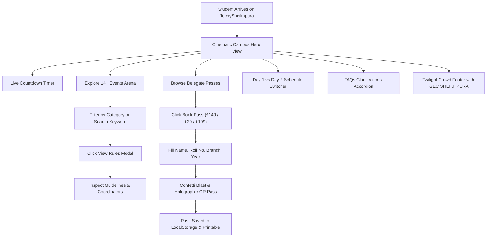

# Product Requirements Document (PRD)

> **TechySheikhpura '26** — *Where Ideas Meet Innovation* | Government Engineering College, Sheikhpura (GEC Sheikhpura), Bihar.

[](TASKS.md)
[](DESIGN.md)
[](ARCHITECTURE.md)

---

## 1. Executive Summary

**TechySheikhpura '26** is the official flagship annual intra-college techno-cultural and innovation festival web platform for **Government Engineering College, Sheikhpura (GEC Sheikhpura)**.

Designed with a custom dark pitch-midnight cyber aesthetic, the platform serves as the central digital hub for **1,200+ engineering students** across all departments to explore competitions, inspect rulebooks, book subsidized delegate passes, generate holographic QR delegate passes, and track the two-day festival schedule.

---

## 2. User Journey Flowchart



---

## 3. Target Audience & Personas

| Persona | Primary Needs | Platform Feature |
|---|---|---|
| **B.Tech Coding Students (CSE / ECE)** | Registering for 24-hour HackArena, WebCraft Studio, and typing sprints. | Event details modal, instant rulebook access, code sprint registration. |
| **Robotics & Hardware Makers (EE / ME)** | Track-O-Bot line tracking, drone derbies (AeroStrike), Circuitrix, and CAD 3D modeling. | Hardware specifications, arena dimensions, dimension checks. |
| **Civil Structural Engineers (CE)** | Bridge structural load destruction testing (Nirman). | Material constraints, load efficiency criteria, venue testing bay. |
| **Esports Competitors (All Branches)** | BGMI and Free Fire MAX custom room entries. | Affordable ₹29 Esports Arena Pass, tournament rules, room timings. |
| **Student Convenors & Faculty** | Disseminating official fest guidelines and schedule. | Unified schedule itinerary, coordinator contact directory. |

---

## 4. Complete 14 Events Arena

> [!NOTE]
> All events are intra-college competitions open exclusively to registered students of GEC Sheikhpura across all batches and branches.

| Event ID | Event Name | Category | Prize Pool | Team Format | Description |
|---|---|---|---|---|---|
| `hackarena` | **HackArena** | Coding | **₹18,000+** | 2–4 Members | 24-Hour continuous collaborative software & AI code sprint. |
| `track-o-bot` | **Track-O-Bot** | Robotics | **₹12,000+** | 1–3 Members | Autonomous micro-robot line-following and obstacle navigation. |
| `aerostrike` | **AeroStrike** | Aero & Drone | **₹10,000+** | 1–2 Pilots | Precision quadcopter obstacle derby through smoke rings and pylons. |
| `speed-stroke` | **Speed Stroke** | Coding | **₹5,000+** | Solo | High-pressure mechanical keyboard typing & debugging race. |
| `pro-to-pitch` | **Pro-To-Pitch** | Startup & Pitch | **₹10,000+** | 1–3 Members | Working prototype and deck presentation before incubation mentors. |
| `decode-gecs` | **Decode GECS** | Fun & Brain | **₹6,000+** | 2–4 Members | Campus-wide cryptic cipher treasure hunt with hidden QR clues. |
| `mechdash` | **MechDash** | Mechanical & Civil | **₹6,000+** | Individual / Pair | 3D CAD parametric modeling and assembly speedrun. |
| `nirman-ignite` | **Nirman (Bridge Crafter)** | Mechanical & Civil | **₹6,000+** | 2–3 Members | Popsicle stick truss bridge structural hydraulic load challenge. |
| `esports-bgmi` | **BGMI Battle Royale** | Esports | **₹8,000** | 4 Players | Competitive custom room squad tournament with shoutcasting. |
| `esports-freefire` | **Free Fire Clash** | Esports | **₹6,000+** | 4 Players | Fast-paced Free Fire MAX Bermuda tournament. |
| `trilexicon` | **TriLexicon** | Fun & Brain | **₹4,000+** | 2 Members | Rapid-fire science & tech trivia buzzer clash. |
| `circuitrix` | **Circuitrix** | Robotics | **₹5,000+** | 1–2 Members | Breadboard debugging & analog/digital hardware hunt. |
| `webcraft` | **WebCraft Studio** | Coding | **₹6,000+** | 1–2 Members | Rapid responsive UI/UX & full-stack web sprint. |
| `technocross` | **TechnoCross** | Fun & Brain | **₹4,000+** | Solo | Engineering crossword & rapid logic puzzle. |

---

## 5. Delegate Pass Tiers

```text
┌─────────────────────────────────┐  ┌─────────────────────────────────┐  ┌─────────────────────────────────┐
│     E-SPORTS ARENA PASS         │  │     ALL-EVENTS TECH PASS        │  │     VIP INNOVATOR ALL-ACCESS    │
│             ₹29                 │  │            ₹149                 │  │            ₹199                 │
│                                 │  │                                 │  │                                 │
│ • BGMI Tournament Entry         │  │ • All 14+ Technical Challenges  │  │ • All Tech + Both Esports       │
│ • Free Fire Squad Room          │  │ • 24H HackArena Access          │  │ • Printed Fest T-Shirt Pack     │
│ • Live Stream Commentary        │  │ • Delegate Lanyard & Fest Kit   │  │ • Priority Benches & Seating    │
│ • Digital Player Badge          │  │ • Verified GECS Certificate     │  │ • 1-on-1 Incubation Mentorship  │
└─────────────────────────────────┘  └─────────────────────────────────┘  └─────────────────────────────────┘
```

---

## 6. Key Success Metrics (KPIs)

- **Page Load Time:** Under 1.5s on 4G mobile connections.
- **Visual Satisfaction:** 100% adherence to the dark futuristic midnight theme (`#020003`).
- **Pass Generation:** Instant client-side holographic QR pass generation with zero server delay.
- **Accessibility:** High-contrast text compliance and Escape/keyboard-navigable dialogs.
