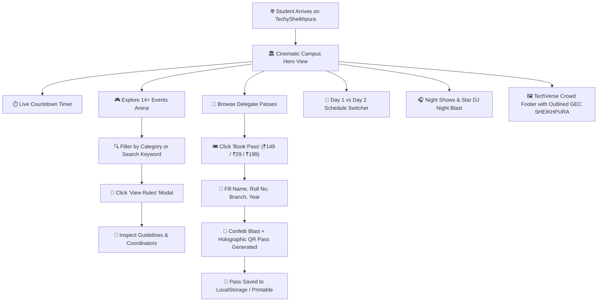

# 📋 Product Requirements Document (PRD)

<div align="center">

# ⚡ TechySheikhpura '26 — Official Fest Platform
### *Where Ideas Meet Innovation*
**Government Engineering College, Sheikhpura (GEC Sheikhpura), Bihar**

---

[](docs/TASKS.md)
[](docs/DESIGN.md)
[](http://localhost:5173/)

</div>

---

## 1. Executive Summary

**TechySheikhpura '26** is the official flagship annual intra-college techno-cultural and innovation festival web platform for **Government Engineering College, Sheikhpura (GEC Sheikhpura)**.

Designed with an aesthetic inspired by `techverse-dce.me`, the platform serves as the central digital hub for **1,200+ engineering students** across all departments to explore competitions, download rulebooks, book subsidized delegate passes, generate holographic QR delegate passes, and experience non-stop technical innovation.

---

## 2. User Journey Flowchart



---

## 3. Target Audience & Personas

| Persona | Primary Needs | Platform Feature |
|---|---|---|
| **B.Tech Coding Students (CSE / ECE)** | Registering for 24-hour HackArena, keyboard speed typing, and debugging sprints. | Event details modal, instant rulebook access, code sprint registration. |
| **Robotics & Hardware Makers (EE / ME)** | Track-O-Bot line tracking, drone derbies (AeroStrike), and CAD 3D modeling. | Hardware specifications, arena dimensions, dimension checks. |
| **Civil Structural Engineers (CE)** | Bridge structural load destruction testing (Nirman). | Material constraints, load efficiency criteria, venue testing bay. |
| **Esports Competitors (All Branches)** | BGMI and Free Fire custom room entries. | Affordable ₹29 Esports Arena Pass, points table rules, room timings. |
| **Student Convenors & Faculty** | Disseminating official fest guidelines and schedule. | Unified schedule itinerary, coordinator contact directory. |

---

## 4. Complete 14+ Events Arena

> [!NOTE]
> All events are intra-college competitions open exclusively to registered students of GEC Sheikhpura across all batches and branches.

| Event ID | Event Name | Category | Prize Pool | Team Format | Description |
|---|---|---|---|---|---|
| `hackarena` | **HackArena** | Coding | **₹18,000** | 2–4 Members | 24-Hour continuous collaborative software & AI code sprint. |
| `track-o-bot` | **Track-O-Bot** | Robotics | **₹12,000** | 1–3 Members | Autonomous micro-robot line-following and obstacle navigation. |
| `aerostrike` | **AeroStrike** | Aero & Drone | **₹10,000** | 1–2 Pilots | Precision quadcopter obstacle derby through smoke rings and pylons. |
| `speed-stroke` | **Speed Stroke** | Coding | **₹5,000** | Solo | High-pressure mechanical keyboard typing & debugging race. |
| `pro-to-pitch` | **Pro-To-Pitch** | Startup & Pitch | **₹10,000** | 1–3 Members | Working prototype and deck presentation before incubation mentors. |
| `decode-gecs` | **Decode GECS** | Fun & Brain | **₹6,000** | 2–4 Members | Campus-wide cryptic cipher treasure hunt with hidden QR clues. |
| `mechdash` | **MechDash** | Mech & Civil | **₹6,000** | 1–2 Members | 3D CAD parametric modeling and assembly speedrun. |
| `nirman-ignite`| **Nirman** | Mech & Civil | **₹6,000** | 2–3 Members | Popsicle stick truss bridge structural hydraulic load challenge. |
| `esports-bgmi` | **BGMI Battle Royale** | Esports | **₹8,000** | 4 Players | Competitive custom room squad tournament with shoutcasting. |
| `esports-ff` | **Free Fire MAX Duel** | Esports | **₹5,000** | Solo / Duo | Battle royale survival tournament on Bermuda. |
| `crossword` | **TechnoCross** | Fun & Brain | **₹4,000** | Individual | Rapid-fire crossword testing engineering terms and general tech trivia. |
| `quiz-master` | **InnoQuiz** | Fun & Brain | **₹5,000** | 2 Members | Multi-round buzzer quiz on tech history, computing, and discoveries. |

---

## 5. Delegate Pass Tiers

```
┌─────────────────────────────────┐  ┌─────────────────────────────────┐  ┌─────────────────────────────────┐
│     ESPORTS ARENA PASS          │  │     ALL-EVENTS PASS ⭐          │  │     VIP ALL-ACCESS PASS         │
│             ₹29                 │  │            ₹149                 │  │            ₹199                 │
│                                 │  │                                 │  │                                 │
│ • BGMI Tournament Entry         │  │ • All 14 Technical Challenges   │  │ • All Events + VIP Lounges      │
│ • Free Fire Squad Room          │  │ • 24H HackArena Access          │  │ • Priority Front-Row Seating    │
│ • Live Stream Shoutout          │  │ • Free Fest Goodie Kit          │  │ • Exclusive Hoodie & Badges     │
│ • Digital Esports Badge         │  │ • DJ Night & Cultural Concert   │  │ • 1-on-1 Incubation Mentorship  │
│                                 │  │ • Verified GECS Certificate     │  │ • Executive Delegate Certificate│
└─────────────────────────────────┘  └─────────────────────────────────┘  └─────────────────────────────────┘
```

---

## 6. Key Success Metrics (KPIs)

- **Page Load Time:** Under 1.5s on 4G mobile connections.
- **Visual Satisfaction:** 100% adherence to the dark futuristic TechVerse theme (`#020003`).
- **Pass Generation:** Instant client-side QR generation with 0 server delay.
- **Accessibility:** High-contrast text compliance and keyboard-navigable dialogs.
