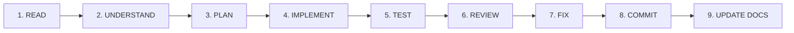

# 🛡️ Engineering & Development Rules

<div align="center">

# ⚡ Vibe Coding Protocol — Engineering Guidelines
**Strict Operational Constraints for TechySheikhpura '26**

---

[](docs/RULES.md)
[](https://www.typescriptlang.org/)
[](https://git-scm.com/)

</div>

---

## 1. Core Engineering Commandments

> [!IMPORTANT]
> The following rules must be followed across all code additions, edits, and refactors in the TechySheikhpura project.

1. **Strict TypeScript Compliance:**
   - No `any` types permitted. Define explicit interfaces for domain models (e.g. `BookedPassData`, `FestEvent`, `FestPass`).
   - Every prop interface must be typed.
2. **Design Integrity:**
   - Adhere strictly to `#020003` background, `#0b0b11` cards, and `Syne` / `Inter` typography defined in [`docs/DESIGN.md`](docs/DESIGN.md).
   - Never inject unrelated templates or random corporate themes.
3. **Preserve User Constraints:**
   - Identity must remain **Government Engineering College, Sheikhpura (GEC Sheikhpura)** and **TechySheikhpura '26**.
   - Background image must remain the authentic Administrative Block (`/gecs-campus.jpg`).
   - The footer must strictly maintain the TechVerse crowd illustration (`/footer-bg.png`) with outlined `GEC SHEIKHPURA` typography.
   - Do NOT add a Google Maps embed back into the layout.

---

## 2. Professional Vibe Coding Workflow

Follow the 9-step development loop for every feature or modification:



---

## 3. Code Standards & Architecture Patterns

### Component Architecture
- Components must live in `src/components/techy/` or `src/components/common/`.
- Pages must live in `src/pages/`.
- Data constants and domain structures belong exclusively in `src/data/techySheikhpuraData.ts`.
- Never write database logic directly inside visual UI components.

### Safe Audio Synthesis
- Always wrap `AudioContext` inside `try-catch` blocks to prevent mobile browser audio autoplay policy exceptions.
- Always ramp oscillator gain to `0.001` before calling `.stop()` to eliminate audible speaker clicks.

---

## 4. Verification & QA Protocol

Before declaring any task complete:
```bash
# 1. Run Oxlint for zero warnings
npm run lint

# 2. Run TypeScript compiler and production build
npm run build
```
Both commands must exit with code `0`.
