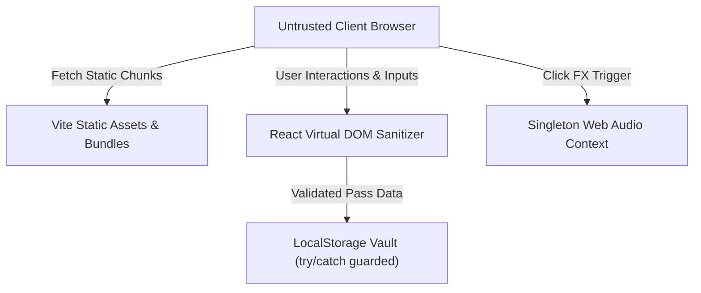

# Security Architecture & Compliance — TechySheikhpura '26

> Official Security Specification for Government Engineering College, Sheikhpura (GEC Sheikhpura), Bihar.

[](https://github.com/Dilkhushkumardev/TechySheikhpura)
[](https://github.com/Dilkhushkumardev/TechySheikhpura)
[](https://github.com/Dilkhushkumardev/TechySheikhpura)

---

## 1. Threat Modeling & Attack Surface



---

## 2. Threat Vector Mitigation Matrix

| Vector / Vulnerability | Risk Rating | Architectural Defense |
|---|---|---|
| **Cross-Site Scripting (XSS)** | High | React 19 automatic JSX text escaping; zero usage of `dangerouslySetInnerHTML`. |
| **Secrets & Token Leakage** | Critical | `.env*` ignored cleanly via `.gitignore`; zero private credentials bundled in client code. |
| **Storage Corruption Crash** | Medium | `localStorage` reads/writes wrapped in defensive `try/catch` with `Array.isArray()` schema guard. |
| **Audio Context Resource Exhaustion** | Medium | Singleton `AudioContext` ref with `gain.exponentialRampToValueAtTime()` and `.close()` cleanup on unmount. |
| **Open Redirect / Reverse Tabnabbing** | Medium | External outbound anchors enforce `rel="noreferrer"` and `target="_blank"`. |
| **Supply Chain Tampering** | High | Pinned lockfile `package-lock.json` integrity hashes. |

---

## 3. Client-Side Input Sanitization Protocol

1. **Pass Booking Form Inputs (`PassBookingModal.tsx`):**
   - Candidate names, roll numbers, phone numbers, and emails are trimmed and validated with inline accessible `role="alert"` feedback prior to submission.
   - Deterministic inline SVG QR matrices are generated locally in memory without sending PII to third-party QR image endpoints.
2. **Search Query Sanitization (`TechySheikhpuraPage.tsx`):**
   - Event filter queries use normalized `.toLowerCase().trim()` substring comparisons, eliminating regex ReDoS risk.

---

## 4. Secure Asset & Audio Lifecycle

- **Asset Integrity:** All external Unsplash images are pinned over HTTPS and verified HTTP 200; static brand visuals live locally in `public/`.
- **Web Audio Safety:**

```typescript
// Safe oscillator cleanup lifecycle
gain.gain.setValueAtTime(0.08, audioCtx.currentTime);
gain.gain.exponentialRampToValueAtTime(0.001, audioCtx.currentTime + 0.08);
osc.stop(audioCtx.currentTime + 0.08);
```

---

## 5. Security Audit Checklist

- [x] Zero API credentials or private keys in repository history.
- [x] Zero usages of `eval()` or `Function()` constructor.
- [x] Zero usages of `dangerouslySetInnerHTML`.
- [x] External anchors include `rel="noreferrer"`.
- [x] Defensive `try/catch` around `localStorage` JSON parsing and Web Audio API.
