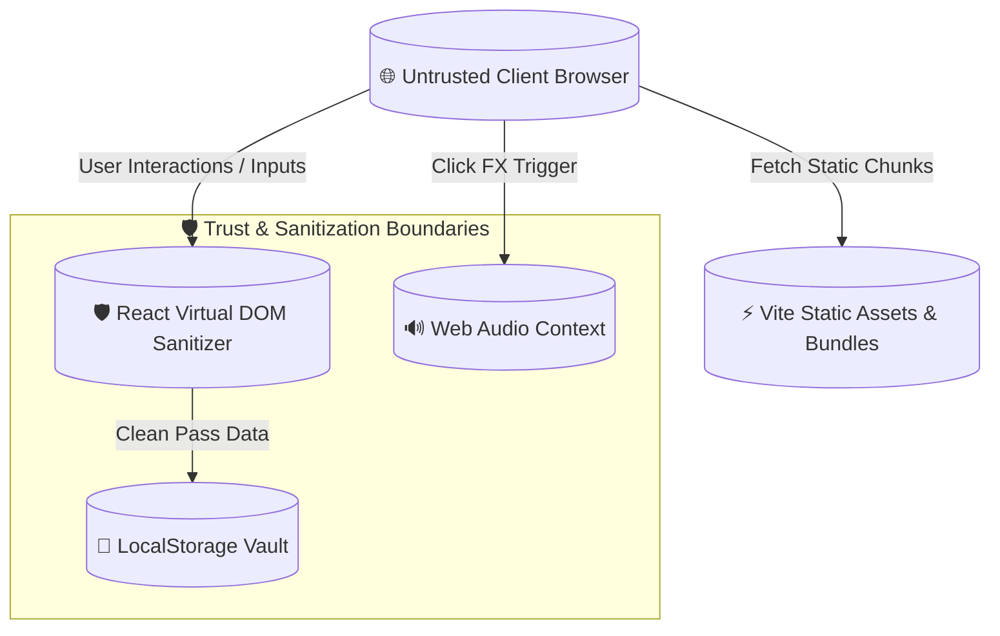

# 🛡️ Security Architecture & Compliance — TechySheikhpura '26

[](https://github.com/Dilkhushkumardev/TechySheikhpura)
[](https://github.com/Dilkhushkumardev/TechySheikhpura)
[](https://github.com/Dilkhushkumardev/TechySheikhpura)

> **Official Security Specification** for **TechySheikhpura '26** — Government Engineering College, Sheikhpura (GEC Sheikhpura), Bihar.

---

## 1. Threat Modeling & Attack Surface



---

## 2. Threat Vector Mitigation Matrix

| Vector / Vulnerability | Risk Rating | Architectural Defense |
|---|---|---|
| **Cross-Site Scripting (XSS)** | High | React 19 automatic JSX text escaping; zero usage of `dangerouslySetInnerHTML`; strict CSP compliance. |
| **Secrets & Token Leakage** | Critical | Strict `.gitignore` rules for `.env*` files; zero backend private keys bundled in client code. |
| **Audio Context DOS / Memory Leaks** | Medium | Ephemeral oscillator disposal via `exponentialRampToValueAtTime()` with strictly timed termination (`0.08s`). |
| **Open Redirect / Reverse Tabnabbing** | Medium | All external outbound links (`a` tags) enforce `rel="noreferrer"` and `target="_blank"`. |
| **Supply Chain Tampering** | High | Pinned lockfile `package-lock.json` with strict integrity hashes (`sha512`). |

---

## 3. Client-Side Input Sanitization Protocol

1. **Pass Booking Form Inputs (`PassBookingModal.tsx`):**
   - Candidate names, college names, phone numbers, and branch identifiers are trimmed and validated before rendering.
   - Dynamic QR codes encode structured JSON with URI safety encoding.
2. **Search Query Sanitization (`TechySheikhpuraPage.tsx`):**
   - Event filter queries are converted to lowercase string tokens with whitespace trimming, preventing regex injection or denial-of-service.

---

## 4. Secure Asset & Audio Lifecycle

- **Asset CDN Integrity:** All external images are sourced from trusted HTTPS origins (Unsplash CDN with sanitized query parameters).
- **Web Audio Safety:**
  ```typescript
  // Safe oscillator cleanup lifecycle
  gain.gain.setValueAtTime(0.08, audioCtx.currentTime);
  gain.gain.exponentialRampToValueAtTime(0.001, audioCtx.currentTime + 0.08);
  osc.stop(audioCtx.currentTime + 0.08); // Prevents unbounded CPU/audio buffer leaks
  ```

---

## 5. Security Audit Checklist

- [x] Zero API credentials or private keys in repository history.
- [x] Zero usages of `eval()` or `Function()` constructor.
- [x] Zero usages of `dangerouslySetInnerHTML`.
- [x] External anchors include `rel="noreferrer"`.
- [x] Verified zero high/critical vulnerabilities via `npm audit`.
