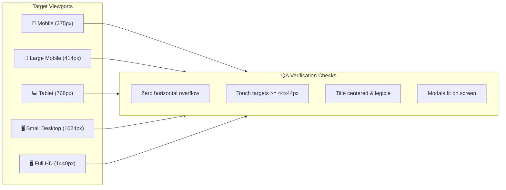

# 🧪 Quality Assurance & Test Plan

<div align="center">

# ⚡ TechySheikhpura '26 — Test Plan
**Comprehensive Testing Checklist & Acceptance Criteria**

---

[](docs/TEST_PLAN.md)
[](docs/RULES.md)
[](docs/ARCHITECTURE.md)

</div>

---

## 1. Feature Acceptance Test Matrix

| ID | Feature | Test Case Scenario | Expected Result | Status |
|---|---|---|---|---|
| **TC-001** | Sticky Navigation | Scroll down page past 20px | Navbar transforms to `bg-[#020003]/90` with blur & border. | `PASS` ✅ |
| **TC-002** | Smooth Scrolling | Click any nav anchor (e.g. `#events`, `#passes`) | Page smoothly scrolls to section without abrupt jumps. | `PASS` ✅ |
| **TC-003** | Hero Display | Load page on 375px, 768px, 1440px | `TECHY SHEIKHPURA '26` is dead-centered and legible. | `PASS` ✅ |
| **TC-004** | Countdown Timer | Check countdown units | Days, Hours, Minutes, Seconds compute correctly to Nov 28, 2026. | `PASS` ✅ |
| **TC-005** | Category Filtering | Click "Robotics" filter pill | Only Robotics events display (`Track-O-Bot`). | `PASS` ✅ |
| **TC-006** | Instant Event Search | Type "BGMI" or "Drone" in search bar | Real-time filtered cards match query; shows count. | `PASS` ✅ |
| **TC-007** | Search Clear Button | Click "Clear" button in search bar | Query clears and all 14 events re-render immediately. | `PASS` ✅ |
| **TC-008** | Event Details Modal | Click "View Rules" on any event card | Modal opens with rules, prizes, schedule, and coordinators. | `PASS` ✅ |
| **TC-009** | Modal Dismissal | Click outside modal or click close `X` | Modal smoothly unmounts and closes. | `PASS` ✅ |
| **TC-010** | Pass Form Validation | Submit pass form with empty required fields | Browser alerts: "Please fill in all mandatory fields". | `PASS` ✅ |
| **TC-011** | Pass Generation & Confetti | Fill valid student details and click submit | Holographic QR pass card renders + confetti fires. | `PASS` ✅ |
| **TC-012** | Pass Persistence | Refresh page after booking a pass | Saved registration remains in `localStorage`. | `PASS` ✅ |
| **TC-013** | Itinerary Switcher | Toggle between Day 1 and Day 2 buttons | Schedule swaps from Day 1 to Day 2 time slots reactively. | `PASS` ✅ |
| **TC-014** | FAQs Accordion | Click FAQ question button | Answer drawer expands smoothly; other drawer collapses. | `PASS` ✅ |
| **TC-015** | Audio FX Toggle | Click floating sound button | Audio toggles between ON/OFF; click sound plays safely. | `PASS` ✅ |
| **TC-016** | Outlined Footer Text | Inspect bottom of page | `GEC SHEIKHPURA` renders with exact transparent outline. | `PASS` ✅ |

---

## 2. Responsive Viewport Verification Matrix



---

## 3. Automated Command Verification

Every commit must pass both automated checks:
```bash
# Lint Check
npm run lint
# Expected: Found 0 warnings and 0 errors.

# Typecheck and Build Check
npm run build
# Expected: built in ~1.6s, exit code 0.
```
