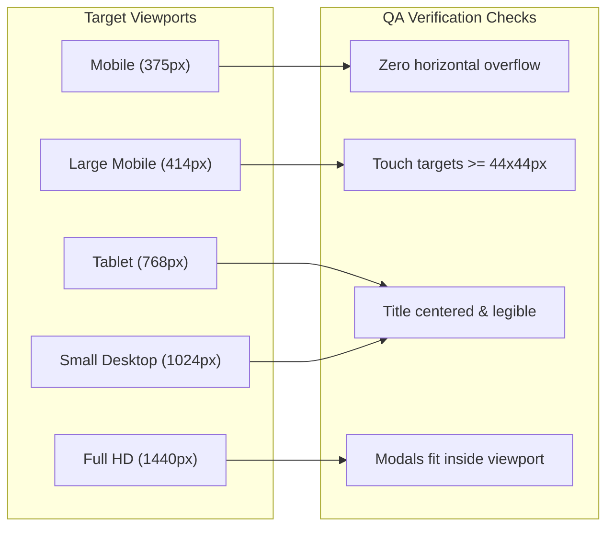

# Quality Assurance & Test Plan

> **TechySheikhpura '26** — Comprehensive Testing Checklist & Acceptance Criteria.

[](TEST_PLAN.md)
[](RULES.md)
[](ARCHITECTURE.md)

---

## 1. Feature Acceptance Test Matrix

| ID | Feature | Test Case Scenario | Expected Result | Status |
|---|---|---|---|---|
| **TC-001** | Sticky Navigation | Scroll down page past 20px | Navbar transforms to `bg-[#020003]/90` with blur & border. | `PASS` |
| **TC-002** | Smooth Scrolling | Click any nav anchor (`#events`, `#passes`, `#faqs`) | Page smoothly scrolls to target section. | `PASS` |
| **TC-003** | Hero Display | Load page on 375px, 768px, 1440px | `Techy Sheikhpura '26` is centered and legible. | `PASS` |
| **TC-004** | Countdown Timer | Inspect countdown units | Days, Hours, Minutes, Seconds count down to Sep 28, 2026. | `PASS` |
| **TC-005** | Category Filtering | Click "Robotics" filter pill | Only Robotics events display (`Track-O-Bot`, `Circuitrix`). | `PASS` |
| **TC-006** | Instant Event Search | Type "BGMI" or "Drone" in search bar | Matching event cards render dynamically with live count. | `PASS` |
| **TC-007** | Search Clear Button | Click "Clear" button in search bar | Query clears and all 14 events re-render immediately. | `PASS` |
| **TC-008** | Event Details Modal | Click "View Rules" on any event card | Modal opens with rules, prizes, schedule, and coordinators; closes on Escape. | `PASS` |
| **TC-009** | Esports Pass Routing | Click Register on BGMI/Free Fire event | Pass booking modal pre-selects the ₹29 E-Sports Arena Pass. | `PASS` |
| **TC-010** | Pass Form Validation | Submit pass form with whitespace/missing fields | Inline validation alert prompts candidate to complete required details. | `PASS` |
| **TC-011** | Pass Generation & Confetti | Submit valid student details | Holographic badge with SVG QR code renders + confetti fires. | `PASS` |
| **TC-012** | Pass Persistence | Submit pass and inspect `localStorage` | Saved registration JSON writes safely under `techy_sheikhpura_passes`. | `PASS` |
| **TC-013** | Itinerary Switcher | Toggle Day 1 and Day 2 buttons | Schedule switches between Day 1 and Day 2 slots cleanly. | `PASS` |
| **TC-014** | FAQs Accordion | Click FAQ question button | Answer drawer expands cleanly; clicking another switches active item. | `PASS` |
| **TC-015** | Audio FX Toggle | Click floating sound button | Reused `AudioContext` plays tone cleanly when toggled ON; closes cleanly on unmount. | `PASS` |
| **TC-016** | Outlined Footer Text | Inspect bottom of page | `GEC SHEIKHPURA` renders with exact transparent stroke across viewports. | `PASS` |

---

## 2. Responsive Viewport Verification Matrix



---

## 3. Automated Command Verification

Every commit must pass both automated checks:

```bash
# Lint Check
npm run lint
# Expected: Found 0 warnings and 0 errors.

# Typecheck and Build Check
npm run build
# Expected: tsc -b && vite build succeeds with exit code 0.
```
